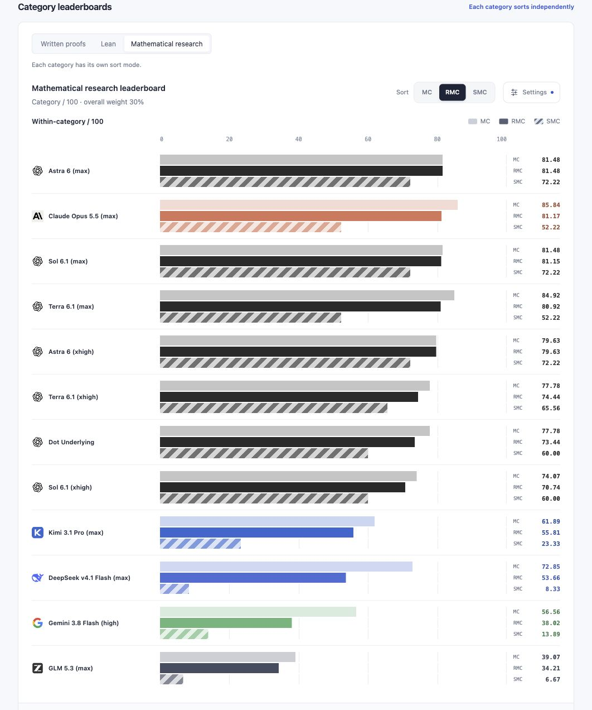

# Math Gauge

[简体中文](README.md) · [English](README.en.md)

**Measure the capability, not just the answer.**

Math Gauge tests whether a model can reliably complete mathematical work: understand supplied structures, calculate and prove, review arguments, turn mathematical specifications into semantically aligned Lean projects, and maintain sound judgments through self-checks.

The **benchmark suite is sealed at 0.6.0**. The latest **distribution is 0.6.1** ([release notes](releases/v0.6.1/README.md)), updating the website, documentation and presentation of adopted results. The previous release and assets remain intact. **AI reviewed, with human spot checks.** Sol 6.1 Max reviews the full set, with sampled cross-checks by Astra 6 Max and Dot; see the [review process](docs/review-process.md).

## Leaderboard preview




Screenshots enable **Completed models only**. Completion does not mean every answer is correct. Each board includes all retained models by default, with unfinished evaluations marked *. Visible metrics, model filters and sorting are independent for each board and persist in the URL, with Chinese and English support. Scores, weights and fixed denominators stay unchanged.

[Static leaderboard](site/index.html) · [Method & data](site/method.html?lang=en) · [Local preview](#local-preview)

Each board has its own **Settings** button at the top right for visible metrics and the completed-model filter; bars, legends and table columns update together within that board. Sort buttons stay visible beside it and work independently of metric visibility. **Score gaps** is a collapsed subboard below the overall leaderboard, using the same disclosure pattern as the additional-results observation under research. The overall sort mode also selects category contributions and result downloads.

**Answer delivery** counts rule-selected initial answers or sealed engineering artifacts out of 39, independently of correctness or goal attainment. Tested tasks without a delivery score zero; untested tasks remain unknown. The three prescribed self-check rounds are listed separately. Harness labels use native product names such as Claude Code and Codex CLI; internal wrapper identities remain in original execution evidence.

An expandable [Volunteered Additional Results observation](site/index.html?category=research&lang=en#research-initiative) now sits under the research leaderboard. It lists verified result-group counts and review coverage for five manuscript tasks, describing what models volunteered beyond the brief. It is not a research-capability score, and more is not necessarily better. There is no full score, percentage or projected ceiling for unrun tasks. The current AI review covers 59 of 65 manuscript slots across thirteen models, including all five manuscripts from the latest DeepSeek and Kimi records; Argon has three unrun slots. See the [observation report](docs/manuscript-observations.md) and [rules](protocol/manuscript-observations.md). Primary scores and content rates are unchanged.

## Design

Mathematical progress can come from finding a better space, object or language for a problem. Grothendieck's “soaking the nut” metaphor in *Récoltes et Semailles* describes surrounding theory gradually making a hard problem accessible; see Colin McLarty's [The Rising Sea](https://www.landsburg.com/grothendieck/mclarty1.pdf), referring to manuscript pages 552–553.

This informs the review criteria: a short proof, counterexample, quotient space or alternative representation may complete a goal. A change of representation must establish the bridge back to the original problem. Assumptions, quantifiers, domains and conclusion strength remain binding; length and resemblance to the reference route do not earn credit.

Using the author's distinction in [AI, Mathematical Ability, and the Future](https://glenzli.com/notes/ai-mathematical-ability-and-the-future/), Lv1 covers calculation, execution and implementation within known objects and rules; Lv2 covers proof or refutation within an existing framework. These are not difficulty levels. This edition tests selected Lv1 / Lv2 work related to OET writing, auditing and formalization: stable assumptions, semantic alignment, recognition of gaps, background checking and theorem extension. Results describe this task set; they do not establish an ability to solve open frontier problems, formulate productive new questions (Lv3), or create mathematical frameworks (Lv4).

## Suite and scoring

| Category | Subcategory | Points | Public | Private | Aggregation |
|---|---|---:|---:|---:|---|
| Written proofs: 35 | Written arguments | 25 | 8 | 4 | 12 equal mathematical families |
| | Answer review | 10 | 4 | 0 | 4 parent argument families |
| Lean: 35 | Semantic audit | 10 | 4 | 0 | 2 mathematical families |
| | Formalization | 15 | 4 | 0 | 2 mathematical families |
| | Alignment self-check | 10 | 1 reused | 0 | Fixed three-round trajectory on 92 obligations |
| Research: 30 | Background checks | 10 | 2 | 2 | 4 independent A1 families |
| | Manuscript completion | 10 | 1 | 4 | 5 equal independent A1 families |
| | Theorem extension | 10 | 2 | 4 | 6 unprompted A1 families |

There are **39 initial tasks, 35 mathematical families, and three additional fixed Lean self-check rounds: 42 prescribed deliveries**. Public and private components share benchmark 0.6.0 and one combined scoring pool. Related variants aggregate within families; there is no separately normalized public overall score. Built capacity is **100 / 100**; unrun tasks retain unknowns and possible intervals. See the [public catalog](cases/README.md), [selection rationale](docs/selection.md) and [scoring protocol](protocol/benchmark-scoring.md).

Three scores use the same retained answers and fixed weights:

- **MC — Mathematical Capability:** valid positive mathematical work, including supported partial progress.
- **RMC — Reliable Mathematical Capability (primary):** retains evidence-based error, regression and false-claim penalties. Ordinary deductions are 5% / 10% / 20%, with root-cause deduplication and a 20% per-task cap (50% for manuscript completion). Established critical core false endorsement, rejection or verification caps that task at 0. Honest incompleteness is not an added error.
- **SMC — Strict Mathematical Completion:** all substantive task requirements must pass. Self-check requires the whole prescribed three-round trajectory, including final 92-obligation completion, accurate diagnosis and no false-complete claims or regressions. The archived machine ID remains `strict`.

Theorem extension and background checks use A1 only, without a scored research invitation. A correct baseline with no extension earns zero research credit; a wrong baseline incurs the specified RMC deduction. Actual false endorsement in background checks forces R0. A loose source-review pass does not establish SMC.

Manuscript completion accepts rigorous, faithful alternative approaches, without requiring imitation of OET or unrequested theory. Public [MG-MCP003](cases/manuscript-completion/MG-MCP003/task.md) is a directed idea-to-manuscript task, frozen before candidate calls and adopted after observation. The newly selected private family has its own frozen core-completion rule; optional independently deletable local errors do not excuse critical errors or faulty core dependencies. The other four families keep their original judgments. See the [method page](site/method.html?lang=en).

## Current results

All values are confirmed contributions in the full 100-point frame. The main view uses the **first normal delivery selected by `nonlogical_retry_3`**, with original failures and every attempt retained. No best-of or union of answers is used.

| Model | Harness | MC | **RMC (primary)** | SMC | Coverage |
| --- | --- | --- | --- | --- | --- |
| Astra 6 (max) | Codex CLI | 94.32 | 94.32 | 89.17 | 39/39 |
| Sol 6.1 (max) | Codex CLI | 94.32 | 94.22 | 89.17 | 39/39 |
| Claude Opus 5.5 (max) | Claude Code | 93.76 | 91.44 | 59.42 | 39/39 |
| Astra 6 (xhigh) | Codex CLI | 91.45 | 90.45 | 79.17 | 39/39 |
| Dot Underlying | Unknown<sup>1</sup> | 91.66 | 90.23 | 78.00 | 39/39 |
| Sol 6.1 (xhigh) | Codex CLI | 90.12 | 87.96 | 68.00 | 39/39 |
| Terra 6.1 (max) | Codex CLI | 87.65 | 86.45 | 65.67 | 39/39 |
| Terra 6.1 (xhigh) | Codex CLI | 79.71 | 78.50 | 63.00 | 39/39 |
| Kimi 3.1 Pro (max) | Claude Code | 75.28 | 70.41 | 43.67 | 39/39 |
| DeepSeek v4.1 Flash (max) | Codex CLI<sup>2</sup> | 76.71 | 65.30 | 25.83 | 39/39 |
| Gemini 3.8 Flash (high) | AGY CLI | 62.32 | 48.42 | 13.75 | 39/39 |
| GLM 5.3 (max) | Claude Code<sup>3</sup> | 36.03 | 27.34 | 14.08 | 39/39 |
| Gemini 4 Argon (high)* | AGY CLI | 36.01 | 32.17 | 17.92 | 23/39 |

*Evaluation unfinished. Complete intervals and coverage remain in model details. All formal tests allow local tools and preinstalled public dependencies; external retrieval and tool networking are prohibited. Model-service / authentication traffic is separate. Harness versions and actual tool use are scoped to the original batches, not inferred across inherited answers.*

¹ Dot's independent native harness. Its underlying SKU is unverified. The original 38 + 3 batch and one historical native first delivery selected after observation are recorded separately, giving 39 + 3 scored deliveries. Native records do not relax CLI import contracts.

² Earlier runs with DeepSeek Harness (DSH) failed to deliver several tasks after lengthy reasoning exhausted the maximum output budget; execution then moved to Codex CLI.

³ GLM 5.3 had frequent timeouts and missed deliveries with both Codex CLI and Claude Code. The retained run uses Claude Code; answers not delivered by the deadline score zero.


Kimi 3.1 Pro (max) now scores MC 75.28 / RMC 70.41 / SMC 43.67, with content reliability 91.14% and complete-goal attainment 68.03%. The user confirmed the C003 R3 power-loss recovery as trustworthy; the same-round diagnosis and repair earn 100/100, giving 91→91→91→92. R1/R2 false-completion deductions and all 47 physical requests remain. See the [current archive](results/v0.6.0/kimi-3.1-pro-max/20261110-r3-recovery/README.md).

Astra 6 (xhigh) completed 39 initial tasks and three fixed self-check rounds: MC 91.45 / RMC 90.45 / SMC 79.17, content reliability 98.68% and complete-goal attainment 87.36%. With the same tasks, tools and budgets, its RMC was 3.87 points below max in this run. The main losses were a core endorsement error in AHR02, the initial C003 delivery at 82 / 92, and lower extension credit; all three C003 rounds reached 92 / 92 with accurate diagnoses and no regression. See the [Astra xhigh record](results/v0.6.0/astra-6-xhigh/20261110/README.md).

Astra 6 (max) completed all 39 initial tasks and three fixed self-check rounds, with 42 first deliveries and no retries. MC / RMC / SMC are 94.32 / 94.32 / 89.17; content reliability is 100% and complete-goal attainment 90.92%. Its initial Lean projects and all self-check rounds passed. MC and SMC tie Sol Max; the 0.10 RMC difference comes from one optional false assertion in Sol. Paired review corrected the network-manuscript fidelity judgment for both answers, which already supplied nodewise operators and organization; original answers and earlier reviews are retained. See the [Astra record](results/v0.6.0/astra-6-max/20261109/README.md).

Both Sol efforts completed 39 initial tasks and all three self-check rounds, each with 42 physical requests and no retries or system exclusions. This batch used Codex CLI 0.167.0-alpha.3.2; missing backend model / effort echoes remain unknown.

Opus delivered all 39 + 3 through Claude Code 2.1.303. Content reliability is 94.22%, goal attainment 85.84%. All four initial formalization tasks were complete; C003 was 92 / 92 from A1 through R3, but R1 misdiagnosed a proof already present in its parent, failing trajectory SMC. Final engineering completeness and diagnosis accuracy remain distinct. Thirty-seven initial tasks used tools, with 338 calls. Collector versions were 0.1.0 / 0.2.0 for the public / private batches; configuration and events were checked, without an independent runtime isolation probe. See the [retained Opus record](results/v0.6.0/claude-opus-5.5-max/20261109/README.md).

DeepSeek’s final composition scores MC 76.71 / RMC 65.30 / SMC 25.83. All 39 initial tasks and three self-check rounds are adjudicated: 38 reviewed answers and one timeout without a final answer. Sources and retry history are in the [final archive](results/v0.6.0/deepseek-v4.1-flash-1017/20261110/README.md). Content reliability is 76.64% and complete-goal attainment is 57.36%, audited on the same shared contracts.

PS001 replaces GR103 in the current selection. Gemini retains only its original A1 review (94 / 100; SMC fail), as selected by the user; independent regrading is excluded. Retired GR103 source answers remain historical evidence and do not enter current aggregation. Current tasks, raw answers, original self-assessments and source policy 0.4.0 are immutable.

## Reading the charts

Every homepage chart has horizontal model rows, a shared zero baseline, aligned right-hand readouts and 2px gaps within each group. MC is pale, RMC solid and SMC broadly striped, without bar outlines. The overall mode controls the main ranking and contributions; written, Lean and research leaderboards each retain their own MC / RMC / SMC sort. The contribution table expands subcategories beside their parent totals.

Reliability Gap **RG = RMC − MC** and Delivery Gap **DG = SMC − MC** are presentation diagnostics in percentage points, not new benchmark scores. They share a signed axis and sort independently by distance from zero. Zero gap is not a capability claim.

[Content reliability and goal attainment](protocol/content-rates.md) assess actual assertions and complete independently usable mathematical results, respectively. Current contracts share 697 assertion units and 149 complete goals, weighted by the original category / family hierarchy. MC may credit partial progress; attainment requires complete goals; SMC requires the entire task and prescribed trajectory. The earlier 0.1.0 fine-unit coverage reports are retained separately. Assertion and goal reviews accompany the retained answers and main scores.

## Running and retaining evidence

Use the [external harness guide](docs/harness-guide.md). Every task gets a fresh runtime / workspace. At most three effective attempts include the first; proven pure system failures do not consume an attempt, output exhaustion does, and normally delivered mathematical errors never permit a retry. The first native terminal state or deadline seals actual source; controller cleanup is separate.

The public candidate package contains 25 tasks. The controlled complete 39-task package and external evaluator plan stay private; both use the same public runner. References, expected truth, rubrics, author implementations, prior answers and reviews are evaluator-side. Public outputs expose only combined private counts, opaque hashes and aggregates. The selected Astra results are additional records; published release snapshots remain unchanged.

## Local preview

```bash
python3 -m http.server 8000 --bind 127.0.0.1
```

Open `http://127.0.0.1:8000/site/?lang=en`. Add `&complete=1` for the screenshot view; remove it to include all models. The site works offline. Regenerate it with `python3 scripts/render_results_site.py`.

Distribution 0.6.1 retains the candidate filename `benchmark-v0.6.0.zip` and frozen suite identity. Each release's `release-lock.json` binds exact source commits and asset hashes; no asset in the earlier release is replaced. RMC 0.8.0 / MC 0.2.0 / SMC 0.2.0; case, harness and scoring revisions remain separate.

[Leaderboard](site/index.html?lang=en) · [Full reports](docs/results.md) · [Distribution 0.6.1](releases/v0.6.1/README.md) · [Sealed 0.6.0 release](releases/v0.6.0/README.md) · [Scoring protocol](protocol/benchmark-scoring.md) · [Result record contract](protocol/result-record.md)
