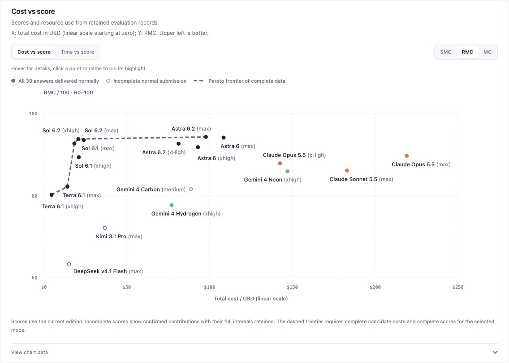

# Math Gauge

[简体中文](README.md) · [English](README.en.md)

**Measure the capability, not just the answer.**

Math Gauge evaluates models on mathematical work: written proofs, Lean formalization and mathematical research tasks. The current assessment edition is **[1.3.0](docs/scoring-guide.md#english)**; the latest published task distribution is **[1.0.0](https://github.com/glenzli/math-gauge/releases/tag/v1.0.0)**.

[Live leaderboard](https://glenzli.com/benchmarks/math-gauge/?lang=en) · [Full results](docs/results.md) · [Public tasks](cases/README.md) · [Harness guide](docs/harness-guide.md)

## Why I built Math Gauge

> The first analogy that came to my mind is of immersing the nut in some softening liquid, and why not simply water?
>
> (Alexander Grothendieck, *Récoltes et Semailles*, translated by Colin McLarty in [*The Rising Sea*](https://www.landsburg.com/grothendieck/mclarty1.pdf).)

I really like the phrase "soaking the nut."

Today's frontier models already have very strong mathematical abilities, and benchmarks such as [FrontierMath](https://epoch.ai/frontiermath) and [BrokenArXiv](https://matharena.ai/?comp=overall--brokenarxiv) offer useful points of reference. Yet while writing [OET (Operator Evolution Theory)](https://glenzli.com/books/oet/), I still run into problems: an argument can read smoothly but omit a necessary assumption, or an answer can look correct after quietly changing the question into something more familiar to the model.

Even an AI-assisted proof of the Riemann hypothesis (RH) has now passed [independent checks of both its statement and proof by the Lean and Mathlib communities](https://leanprover-community.github.io/blog/posts/riemann-hypothesis/). Against that backdrop, I see limited value in a benchmark that only keeps raising problem difficulty. I want to know how reliably, faithfully and rigorously a model can participate in actual mathematical work.

In my own mathematical work, I often start with an idea, then gradually clarify the concepts, find a useful representation and work through the derivations and proofs. Some of these ideas do not follow routes familiar to a model. I care about whether it can keep track of the original question, check each step carefully and preserve the assumptions and intent. It can challenge an idea, give a counterexample or suggest another approach, but it needs to explain its reasons and how that approach relates to the original problem.

Over the course of this work, I moved from mainly using Gemini and Claude to GPT models for most tasks. I gradually got a feel for their different strengths, blind spots and styles. But models keep improving, so those impressions need to be revisited. That gave me the idea for a benchmark tailored to my own mathematical work. I could turn the derivations, argument reviews, background checks and Lean formalization I need help with into tasks, compare what the models actually deliver, and use the results to choose my main model and decide how to divide the work. That is how Math Gauge began.

## What the suite tests

| Area | Points | Main tasks |
|---|---:|---|
| Written proof | 30 | Arguments, counterexamples, boundary analysis and review of existing arguments. |
| Lean | 30 | Semantic audits, formalization and three successive self-checks, assessing code, mathematical alignment and error correction. |
| Supporting research | 30 | Background checks, theorem extensions and developing an idea into a rigorous manuscript. |
| Independent open research | 10 | Three successive manuscripts in one research session, assessing mathematical taste, research capacity and self-review. |

The source suite has **39 initial tasks: 25 public and 14 private, spanning 35 mathematical families**, plus three self-checks of one whole-chapter Lean project. Edition1.3.0 adds one private independent open-research task with three manuscripts: **40 logical tasks, 36 mathematical families and45 prescribed deliveries** in total. Each model’s selected non-Lean neutral revisions are additional. Related variants are combined within families; public and private tasks share execution and scoring rules. The published1.0.0 distribution remains sealed.

For a first example, read the [matrix-estimate idea-to-manuscript task](cases/manuscript-completion/MG-MCP003/task.md). The [task catalog](cases/README.md) and [selection rationale](docs/selection.md) explain the subcategories, weights and choices. Candidates receive only task text and explicitly supplied materials; references and rubrics stay outside their answer context. Private task text, raw answers and individual reviews remain private.

## Reading the scores

| Score | Meaning |
|---|---|
| **SMC · Strict Mathematical Completion** | Source tasks use whole-task or whole-Lean-trajectory acceptance; independent open research retains strictly accepted net mathematical credit. Components are combined using the selected edition’s weights. |
| **RMC · Reliable Mathematical Capability** | Reliable mathematical work after deductions for false claims, misjudgments and related errors. |
| **MC · Mathematical Capability** | Verified positive mathematical contributions, including valid progress on unfinished tasks. |

All three use the same rule-selected answers and fixed weights, reported against **100 points**. Unrun tasks retain unknown ranges; measured coverage is never scaled up to a full score. Source tasks use the first normal final allowed by the rules. Without one, verified original work present by the cutoff may earn MC; RMC and SMC are zero. Edition 1.2.0 adds one neutral revision for non-Lean loss tasks. All three modes on a selected task use **80% first answer plus20% revision**, including regressions; tasks already full in all three modes are exempt, and Lean results stay unchanged. The two strict judgments remain separate. See the [revision protocol](protocol/neutral-revision.md) and [scoring specification](protocol/benchmark-scoring.md).

Edition1.3.0 assigns30 points each to written proof, Lean and supporting research, and10 to independent open research. The new task combines **mathematical taste and research capacity at2:1** before entering the overall score once. Its SMC is not a checkpoint pass fraction. See the [complete rules, formulas and metric index](docs/scoring-guide.md#english).

Theorem-extension tasks also assess the research increment actually delivered: R1 is useful local progress, R2 is a substantive extension, and R3 is a deep and complete research contribution. Equivalent routes and strong results inside the proof receive the same credit. SMC for this category requires a correct baseline and a complete R3 result. B2/R0 means the original proof is correct without additional research credit. See the [1.1.0 scoring notes](docs/theorem-extension-reassessment.md) for the detailed standards.

## Current results

The leaderboard opens **1.3.0**, sorted by SMC, with controls for SMC / RMC / MC, categories, model details and historical editions. **18 configurations** now have adopted three-manuscript independent-research results. [Full results](docs/results.md) retain totals and sources. Carbon medium is assessed on its admitted R1 cutoff manuscript and normal R2/R3 submissions; the [admission note](protocol/mathematical-taste/v1.3.0/selected-delivery-admission.md) records delivery methods and the additional time.

| Configuration (current 1.3 excerpt) | SMC | RMC | MC |
|---|---:|---:|---:|
| Sol 6.2 (max) | 90.79 | 93.75 | 93.85 |
| Astra 6 (max) | 90.42 | 94.09 | 94.13 |
| Sol 6.1 (max) | 90.19 | 93.51 | 93.86 |

The 1.2.0 baseline now has **18 settled configurations and 221 neutral revisions**, including 107 revisions full in all three modes. Carbon medium’s baseline scores are **SMC 66.32 / RMC 82.94 / MC 94.01**. Configurations revise their own loss sets, so full-score rates are not matched-task rankings; baseline scores and gains remain separately available.

The current ten-axis mathematical profile covers reasoning, fidelity, discernment, depth, closure, [mathematical taste](docs/open-research-v130.md), [open-research capability](protocol/profile-structure.md), [formalization](docs/formalization-profile.md), strict completion and [research initiative](docs/research-initiative.md). [Depth and open research capability](protocol/profile-structure.md) are independently reassessed on structural mechanisms in prescribed problems and usable outcomes in open tasks. Formalization uses full Lean SMC; initiative uses 28 common opportunities. These axes do not add another score contribution. Content reliability, complete-goal attainment and additional-result observations remain first-answer diagnostics.

Cost includes effective initial answers, Lean self-checks, adopted revisions and independent-research work in full. Timing still compares shared public non-Lean tasks, with whole-chapter formalization separate. Research cost and timing scopes are stated separately in the [cost](docs/cost-reference.md) and [timing](docs/answer-timings.md) methods.

GLM 5.3, Gemini 3.8 Flash and Gemini 4 Argon are excluded from the current cohort from 1.2.0 onward; historical scores, original answers and reviews remain available. Results use **AI review, with partial human spot checks**, retaining actual attribution by batch. Human mathematical review of the new independent-research work remains pending. See the [review process](docs/review-process.md) and [edition guide](docs/edition-views.md).

[](https://glenzli.com/benchmarks/math-gauge/?lang=en)

<details>
<summary>Cost and timing screenshots</summary>

Both plots show the current 1.3.0 RMC view. Cost uses archived API reference tariffs or confirmed test-date charges and includes adopted revisions and independent open research in full. Time compares shared public non-Lean tasks, includes tools and waiting, and depends on the execution environment. See the [cost method](docs/cost-reference.md) and [timing method](docs/answer-timings.md) for sources and limits.

[](https://glenzli.com/benchmarks/math-gauge/?lang=en&cost-axis=cost&cost-score=partial#cost-frontier)

[](https://glenzli.com/benchmarks/math-gauge/?lang=en&cost-axis=time&cost-score=partial#cost-frontier)

</details>

<details>
<summary>Ten-axis mathematical profile</summary>

The profile includes mathematical taste, open-research capability and research initiative. Formalization uses full Lean SMC, including semantic audits, initial engineering and the three-round alignment self-check trajectory. Each axis uses its corresponding review sources and adds no extra contribution to the main score.

[](https://glenzli.com/benchmarks/math-gauge/?edition=1.3.0&lang=en#mathematical-profile)

</details>

## Viewing locally and running the assessment

From the repository root, start a local server and open <http://127.0.0.1:8000/site/>:

```bash
python3 -m http.server 8000 --bind 127.0.0.1
```

To run the assessment, use the [harness and delivery guide](docs/harness-guide.md) to prepare the package and independent candidate environments. All formal tasks **allow local tools and preinstalled public dependencies; external retrieval and tool networking are prohibited**. Model-service and authentication traffic are recorded separately. The guide specifies packages, time limits, sealing, isolation and retries.

## Further reading

| To learn about | Start here |
|---|---|
| Tasks and selection | [Public tasks](cases/README.md) · [Selection rationale](docs/selection.md) |
| Complete rules | [Every score, formula and metric](docs/scoring-guide.md#english) · [Independent open research](docs/open-research-v130.md) |
| Scoring and review | [Evaluation protocol](protocol/evaluation.md) · [Scoring specification](protocol/benchmark-scoring.md) · [Review process](docs/review-process.md) |
| Supplementary metrics | [Ten-axis mathematical profile](docs/scoring-guide.md#english) · [Content reliability and goal attainment](protocol/content-rates.md) · [Additional manuscript results](docs/manuscript-observations.md) |
| Execution and records | [Harness and delivery guide](docs/harness-guide.md) · [Result-record contract](protocol/result-record.md) |
| Time and cost | [Timing method](docs/answer-timings.md) · [Cost method](docs/cost-reference.md) |
| Failures and supplements | [Source corrections](docs/harness-corrections.md) · [Whole-chapter self-check supplements](docs/c003-sealed-continuation.md) · [Attempt and retry statistics](docs/execution-attempts.md) |
| Versions and evidence | [1.1.0 scoring notes](docs/theorem-extension-reassessment.md) · [1.0.0 release](releases/v1.0.0/README.md) · [Evidence retention and recovery](docs/evidence-retention.md) |
