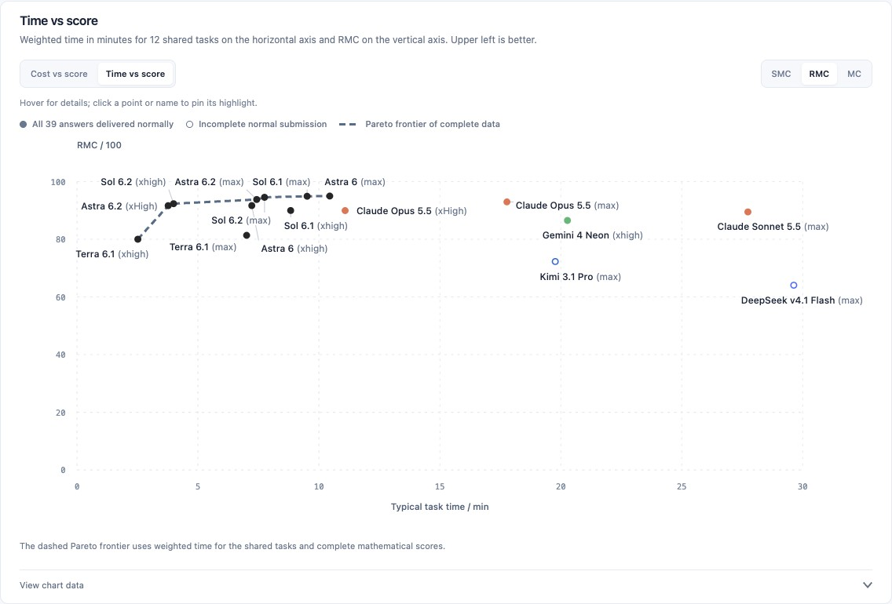

# Math Gauge

[简体中文](README.md) · [English](README.en.md)

**Measure the capability, not just the answer.**

Math Gauge evaluates models on mathematical work: written proofs, Lean formalization and mathematical research tasks. The current scoring edition is **[1.2.0](docs/neutral-revision.md)**; the latest published task distribution is **[1.0.0](https://github.com/glenzli/math-gauge/releases/tag/v1.0.0)**.

[Live leaderboard](https://glenzli.com/benchmarks/math-gauge/?lang=en) · [Full results](docs/results.md) · [Public tasks](cases/README.md) · [Harness guide](docs/harness-guide.md)

## Why I built Math Gauge

> The first analogy that came to my mind is of immersing the nut in some softening liquid, and why not simply water?
>
> (Alexander Grothendieck, *Récoltes et Semailles*, translated by Colin McLarty in [*The Rising Sea*](https://www.landsburg.com/grothendieck/mclarty1.pdf).)

I really like the phrase "soaking the nut."

Today's frontier models already have very strong mathematical abilities, and benchmarks such as [FrontierMath](https://epoch.ai/frontiermath) and [BrokenArXiv](https://matharena.ai/?comp=overall--brokenarxiv) offer useful points of reference. Yet while writing [OET (Operator Evolution Theory)](https://glenzli.com/books/oet/), I still run into problems: an argument can read smoothly but omit a necessary assumption, or an answer can look correct after quietly changing the question into something more familiar to the model.

Even an AI-assisted proof of the Riemann hypothesis (RH) has now passed [independent checks of both its statement and proof by the Lean and Mathlib communities](https://leanprover-community.github.io/blog/posts/riemann-hypothesis/). Against that backdrop, I see limited value in a benchmark that only keeps raising problem difficulty. I want to know how reliably, faithfully and rigorously a model can participate in actual mathematical work.

In my own mathematical work, I often start with an idea, then gradually clarify the concepts, find a useful representation and work through the derivations and proofs. Some of these ideas do not follow routes familiar to a model. I care about whether it can keep track of the original question, check each step carefully and preserve the assumptions and intent. It can challenge an idea, give a counterexample or suggest another approach, but it needs to explain its reasons and how that approach relates to the original problem.

Over the course of this work, I moved from mainly using Gemini and Claude to GPT models for most tasks. I gradually got a feel for their different strengths, blind spots and styles. But models keep improving, so those impressions need to be revisited. That gave me the idea for a benchmark tailored to my own mathematical work. I could turn the derivations, argument reviews, background checks and Lean formalization I need help with into tasks, compare what the models actually deliver, and use the results to choose my main model and decide how to divide the work. That is how Math Gauge began.

## What the suite tests

| Area | Points | Main tasks |
|---|---:|---|
| Written proof | 35 | Arguments, counterexamples, boundary analysis and review of existing arguments. |
| Lean | 35 | Semantic audits, formalization and three successive self-checks, assessing code, mathematical alignment and error correction. |
| Mathematical research | 30 | Background checks, theorem extensions and developing an idea into a rigorous manuscript. |

The full assessment has **39 initial tasks: 25 public and 14 private, spanning 35 mathematical families**. Three self-check rounds continue the same whole-chapter Lean project, giving 42 prescribed deliveries. Related variants are aggregated within families; public and private tasks share the same runner and scoring rules.

For a first example, read the [matrix-estimate idea-to-manuscript task](cases/manuscript-completion/MG-MCP003/task.md). The [task catalog](cases/README.md) and [selection rationale](docs/selection.md) explain the subcategories, weights and choices. Candidates receive only task text and explicitly supplied materials; references and rubrics stay outside their answer context. Private task text, raw answers and individual reviews remain private.

## Reading the scores

| Score | Meaning |
|---|---|
| **SMC · Strict Mathematical Completion** | Each delivery receives binary whole-task credit; edition1.2.0 weights the first and revision judgments. Lean self-checking still uses the complete three-round trajectory. |
| **RMC · Reliable Mathematical Capability** | Reliable mathematical work after deductions for false claims, misjudgments and related errors. |
| **MC · Mathematical Capability** | Verified positive mathematical contributions, including valid progress on unfinished tasks. |

All three use the same rule-selected answers and fixed weights, reported against **100 points**. Unrun tasks retain unknown ranges; measured coverage is never scaled up to a full score. Each task uses the first normal final allowed by the rules. Without one, verified original work present by the cutoff may earn MC; RMC and SMC are zero. Edition1.2.0 adds one neutral revision for non-Lean loss tasks. All three modes on a selected task use **80% first answer plus20% revision**, including regressions; tasks already full in all three modes are exempt, and Lean results stay unchanged. The two strict judgments remain separate. See the [revision protocol](protocol/neutral-revision.md) and [scoring specification](protocol/benchmark-scoring.md).

Theorem-extension tasks also assess the research increment actually delivered: R1 is useful local progress, R2 is a substantive extension, and R3 is a deep and complete research contribution. Equivalent routes and strong results inside the proof receive the same credit. SMC for this category requires a correct baseline and a complete R3 result. B2/R0 means the original proof is correct without additional research credit. See the [1.1.0 scoring notes](docs/theorem-extension-reassessment.md) for the detailed standards.

## Current results

The leaderboard opens **1.2.0**, sorted by SMC, with controls for SMC / RMC / MC, category scores and model details. It now includes **17 settled configurations and 206 neutral revisions**, of which 102 are full in all three modes. Each configuration revises its own loss set, so these rates are not a same-task ranking. The [full results](docs/results.md) retain score tables and batch notes; [edition switching](docs/edition-views.md) explains access to historical results.

[Gemini 4 Neon (xHigh)](https://glenzli.com/benchmarks/math-gauge/models/gemini-4-neon-xhigh/?lang=en) completed 39 initial tasks, three Lean self-checks and 18 neutral revisions. Its 1.2.0 scores are **SMC 61.17 / RMC 86.98 / MC 93.52**; two of its 18 revisions are full in all three modes. See the [run results](docs/results.md#gemini-4-neon-xhigh--2026-11-22) for categories, original answers, execution conditions and reference resources.

All six theorem-extension tasks have undergone a [uniform original-answer review](docs/theorem-extension-review-corrections.md), correcting five missed contributions. Rankings, category scores and the screenshots below are updated.

Costs include the full resource use of effective initial answers, self-checks and adopted revisions. Timing compares 12 commonly timed public non-Lean tasks, with whole-chapter formalization separate. Nine-axis mathematical profiles offer first-answer and revision-inclusive stages, separately show [formalization](docs/formalization-profile.md), and distinguish [open research capability from research initiative](docs/open-research.md). Content reliability, complete-goal attainment and additional-result observations remain first-answer diagnostics.

GLM 5.3, Gemini 3.8 Flash and Gemini 4 Argon are withdrawn from 1.2.0; their 1.1.0 and earlier scores, original answers and reviews are retained. Other selected configurations awaiting returns remain available in earlier editions. Results use **AI review, with partial human spot checks**, retaining actual reviewer attribution by batch. Human mathematical review of Neon remains pending. See the [review process](docs/review-process.md) and [revision notes](docs/neutral-revision.md).

[](https://glenzli.com/benchmarks/math-gauge/?lang=en)

<details>
<summary>Cost and timing screenshots</summary>

Both plots show the current 1.2.0 RMC view. Cost uses archived API reference tariffs or confirmed test-date charges and includes adopted revisions in full. Time includes tools and waiting and depends on the execution environment. See the [cost method](docs/cost-reference.md) and [timing method](docs/answer-timings.md) for sources and limits.

[](https://glenzli.com/benchmarks/math-gauge/?lang=en&cost-axis=cost&cost-score=partial#cost-frontier)

[](https://glenzli.com/benchmarks/math-gauge/?lang=en&cost-axis=time&cost-score=partial#cost-frontier)

</details>

<details>
<summary>Nine-axis mathematical profile</summary>

Formalization uses full Lean SMC, including semantic audits, initial engineering and the three-round alignment self-check trajectory. Both stages retain the same results, with no new candidate calls or changes to main scores.

[](https://glenzli.com/benchmarks/math-gauge/?lang=en&profile-stage=first#mathematical-profile)

</details>

## Viewing locally and running the assessment

From the repository root, start a local server and open <http://127.0.0.1:8000/site/>:

```bash
python3 -m http.server 8000 --bind 127.0.0.1
```

To run the assessment, use the [harness and delivery guide](docs/harness-guide.md) to prepare the package and independent candidate environments. All formal tasks **allow local tools and preinstalled public dependencies; external retrieval and tool networking are prohibited**. Model-service and authentication traffic are recorded separately. The guide specifies packages, time limits, sealing, isolation and retries.

## Further reading

| To learn about | Start here |
|---|---|
| Tasks and selection | [Public tasks](cases/README.md) · [Selection rationale](docs/selection.md) |
| Scoring and review | [Evaluation protocol](protocol/evaluation.md) · [Scoring specification](protocol/benchmark-scoring.md) · [Review process](docs/review-process.md) |
| Supplementary metrics | [Mathematical profile: first answers / including revisions](docs/mathematical-profile-revision.md) · [Content reliability and goal attainment](protocol/content-rates.md) · [Additional manuscript results](docs/manuscript-observations.md) |
| Execution and records | [Harness and delivery guide](docs/harness-guide.md) · [Result-record contract](protocol/result-record.md) |
| Time and cost | [Timing method](docs/answer-timings.md) · [Cost method](docs/cost-reference.md) |
| Failures and supplements | [Source corrections](docs/harness-corrections.md) · [Whole-chapter self-check supplements](docs/c003-sealed-continuation.md) · [Attempt and retry statistics](docs/execution-attempts.md) |
| Versions and evidence | [1.1.0 scoring notes](docs/theorem-extension-reassessment.md) · [1.0.0 release](releases/v1.0.0/README.md) · [Evidence retention and recovery](docs/evidence-retention.md) |
