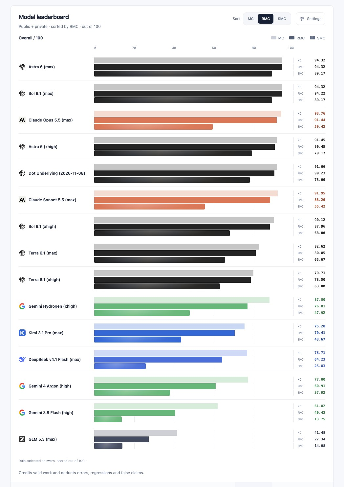
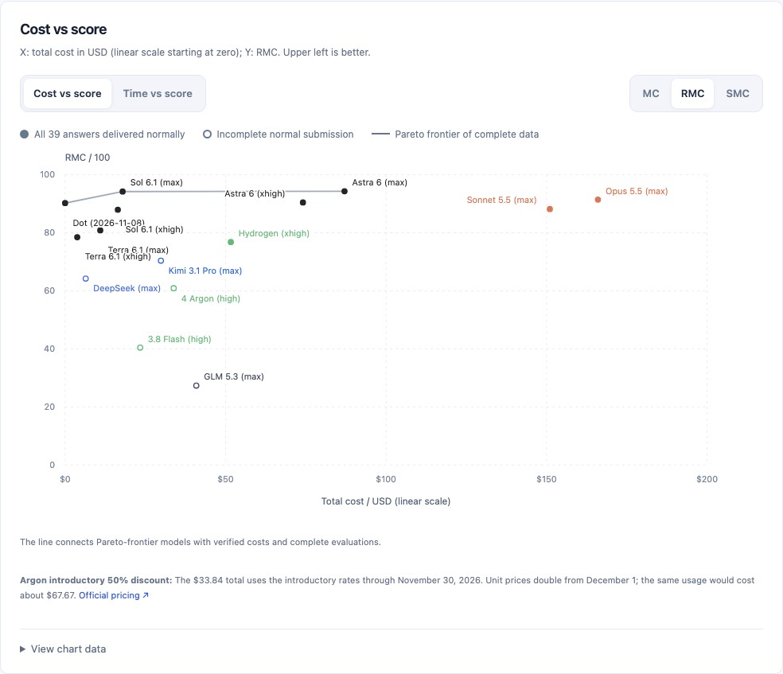
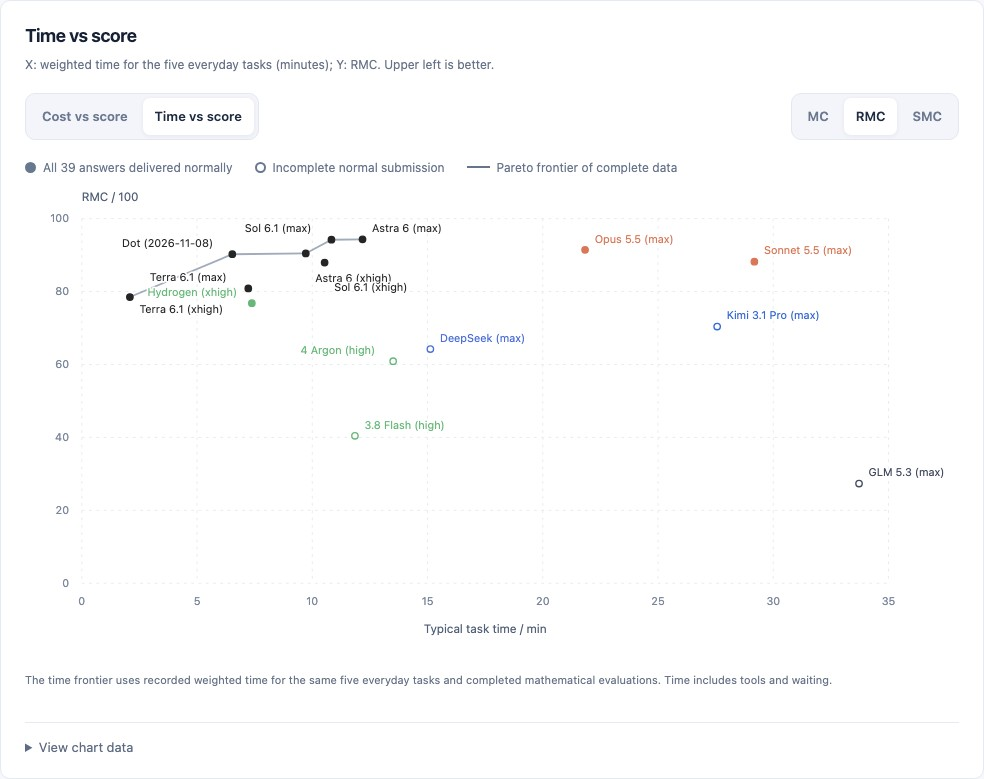

# Math Gauge

[简体中文](README.md) · [English](README.en.md)

**Measure the capability, not just the answer.**

Math Gauge measures whether models can perform mathematical work reliably: prove and refute, review arguments, turn natural-language goals into semantically aligned Lean projects, check research premises, extend propositions, and develop ideas into rigorous manuscripts.

The current formal release is **benchmark 1.0.0**. Public and private tasks form one benchmark, with a shared runner and scoring rules. This release reuses archived 0.6 answers while preserving their original execution identities, responses and reviews; the [release notes](releases/v1.0.0/README.md) record compatibility.

[Leaderboard](site/index.html?lang=en) · [Full results](docs/results.md) · [Task catalog](cases/README.md) · [Harness guide](docs/harness-guide.md)

## Design

Mathematical progress can come from finding spaces, objects and languages that make a problem simpler. In *Récoltes et Semailles*, Grothendieck compares this process to soaking a nut until its shell opens. Math Gauge adopts this emphasis on finding useful mathematical structures. See Colin McLarty's [The Rising Sea](https://www.landsburg.com/grothendieck/mclarty1.pdf), which translates the passage on manuscript pages 552–553.

A short proof, counterexample, quotient construction or alternative representation can complete a task. A change of representation needs a proved correspondence and a bridge back to the original question, preserving assumptions, quantifiers, domains and conclusion strength. Rigorous, faithful alternatives can earn full marks; length and similarity to the reference route carry no credit themselves.

Following the author's [AI, Mathematical Ability, and the Future](https://glenzli.com/notes/ai-mathematical-ability-and-the-future/), **Lv1** covers calculation, execution and implementation with known objects and rules. **Lv2** covers proof and refutation within an existing framework of definitions, axioms, language and questions. These describe kinds of work; very difficult calculations and proofs can belong to either.

This generation samples Lv1/Lv2 abilities needed for OET mathematical writing, review and formalization, asking whether they can be used reliably: do conditions drift through a long argument, does formalization prove the intended statement, does self-checking find and repair gaps, and does research compound a faulty premise? Independently solving frontier open problems is outside the suite's requirements. Productive question formation and the creation of mathematical frameworks need further forms of assessment.

## Suite structure

| Category | Subcategory | Points | Public tasks | Private tasks | Aggregation unit |
|---|---|---:|---:|---:|---|
| Written proof · 35 | Written arguments | 25 | 8 | 4 | 12 mathematical families |
| | Argument review | 10 | 4 | 0 | 4 parent families |
| Lean · 35 | Semantic audit | 10 | 4 | 0 | 2 mathematical families |
| | Formalization | 15 | 4 | 0 | 2 mathematical families |
| | Alignment self-check | 10 | Reuses 1 task | 0 | Three fixed rounds on a 92-obligation chapter |
| Mathematical research · 30 | Background check | 10 | 2 | 2 | 4 mathematical families |
| | Idea-to-manuscript completion | 10 | 1 | 4 | 5 mathematical families |
| | Theorem extension | 10 | 2 | 4 | 6 mathematical families |

There are **39 initial tasks: 25 public and 14 private, spanning 35 mathematical families**. Three successive self-check rounds reuse the same whole-chapter Lean project, giving 42 prescribed deliveries. Related variants are aggregated within families; public and private contributions share a fixed 100-point total.

Written tasks test proofs, boundaries and counterexamples. Lean tasks scale to partial and full chapters, assessing kernel acceptance, semantic alignment and sustained self-checking separately. Research tasks ask models to check premises, attempt extensions, or make an idea rigorous. Public example [MG-MCP003](cases/manuscript-completion/MG-MCP003/task.md) starts from matrix-estimate ideas and requires a complete mathematical manuscript.

Public tasks support replication and inspection; private tasks add undisclosed mathematical problems. Candidates receive only task text and explicitly supplied materials. Private references, rubrics, raw answers and detailed reviews remain private; public reports show their combined contributions. See the [selection rationale](docs/selection.md).

## Reading the scores

| Metric | What it measures |
|---|---|
| **MC · Mathematical Capability** | Positive credit for valid mathematical results, including verified partial progress. |
| **RMC · Reliable Mathematical Capability** | Valid work after deductions for false claims and misjudgments; the default primary score. |
| **SMC · Strict Mathematical Completion** | Acceptance of the complete task goal; Lean self-checking additionally requires the full three-round trajectory to meet completeness, diagnosis and no-regression rules. |

All three use the same rule-selected answers, families and weights. Incorrect work receives no credit merely for being present; compilation also requires a separate check against the mathematical goal. Honest incompleteness and a false claim of completeness have different reliability consequences.

Current aggregation is **0.9.0**, MC **0.3.0**, SMC **0.2.0**, with submission component **0.1.0**. A normal final limits all three scores to the actually delivered work. Without one, verified original work present by the cutoff may earn MC; RMC and SMC are zero. Finals and collected content are mutually exclusive counts. Original 0.8.0 records and reviews remain source-bound.

[Content reliability and complete-goal attainment](protocol/content-rates.md) provide two further views: correctness and support of actual delivered content, and acceptance of complete independent goals required by a task. The research panel's [additional-results observation](docs/manuscript-observations.md) counts verified result groups not requested by the original task. It is separate from the scores and currently covers 72 of 75 manuscript slots across 15 models.

## Current leaderboard

Rows are sorted by RMC. Every score is reported in the fixed 100-point frame. Permitted retries select the first normal delivery under the rules; source records retain the process. Some tests reuse prior answers produced under equivalent conditions.

| Model | Harness | MC | **RMC (main)** | SMC | Finals / collected / tasks |
|---|---|---:|---:|---:|---:|
| [Astra 6 (max)](site/models/astra-6-max/index.html) | Codex CLI | 94.32 | 94.32 | 89.17 | 39 / 0 / 39 |
| [Sol 6.1 (max)](site/models/sol-6.1-max/index.html) | Codex CLI | 94.32 | 94.22 | 89.17 | 39 / 0 / 39 |
| [Claude Opus 5.5 (max)](site/models/claude-opus-5.5-max/index.html) | Claude Code | 93.76 | 91.44 | 59.42 | 39 / 0 / 39 |
| [Astra 6 (xhigh)](site/models/astra-6-xhigh/index.html) | Codex CLI | 91.45 | 90.45 | 79.17 | 39 / 0 / 39 |
| [Dot Underlying (2026-11-08)](site/models/dot-underlying-model-20261108/index.html) | Dot native harness¹ | 91.66 | 90.23 | 78.00 | 39 / 0 / 39 |
| [Claude Sonnet 5.5 (max)](site/models/claude-sonnet-5.5-max/index.html) | Claude Code | 91.95 | 88.20 | 55.42 | 39 / 0 / 39 |
| [Sol 6.1 (xhigh)](site/models/sol-6.1-xhigh/index.html) | Codex CLI | 90.12 | 87.96 | 68.00 | 39 / 0 / 39 |
| [Terra 6.1 (max)](site/models/terra-6.1-max/index.html) | Codex CLI | 82.62 | 80.85 | 65.67 | 39 / 0 / 39 |
| [Terra 6.1 (xhigh)](site/models/terra-6.1-xhigh/index.html) | Codex CLI | 79.71 | 78.50 | 63.00 | 39 / 0 / 39 |
| [Gemini Hydrogen (xhigh)](site/models/gemini-4-hydrogen-xhigh/index.html) | AGY CLI⁴ | 87.80 | 76.81 | 47.92 | 39 / 0 / 39 |
| [Kimi 3.1 Pro (max)](site/models/kimi-3.1-pro-max/index.html) | Claude Code | 75.28 | 70.41 | 43.67 | 38 / 0 / 39 |
| [DeepSeek v4.1 Flash (max)](site/models/deepseek-v4.1-flash-1017/index.html) | Codex CLI² | 76.71 | 64.23 | 25.83 | 37 / 1 / 39 |
| [Gemini 4 Argon (high)](site/models/gemini-4-argon/index.html) | AGY CLI⁴ | 77.00 | 60.91 | 37.92 | 38 / 1 / 39 |
| [Gemini 3.8 Flash (high)](site/models/gemini-3.8-flash-high/index.html) | AGY CLI⁴ | 61.82 | 40.43 | 13.75 | 38 / 1 / 39 |
| [GLM 5.3 (max)](site/models/glm-5.3-max/index.html) | Claude Code³ | 41.48 | 27.34 | 14.08 | 21 / 5 / 39 |

Per-round sources and full score intervals are available in model details. Tested tasks that time out without a submission are scored under the failure rules.

¹ Dot's native independent execution mode.

² Under DeepSeek Harness (DSH), many tasks exhausted the maximum output budget through prolonged reasoning without delivering an answer, so execution uses Codex CLI.

³ GLM 5.3 had frequent timeouts under both Codex CLI and Claude Code; the retained results use Claude Code. Without a normal final, RMC and SMC are zero; verified original work may earn MC. The three self-check rounds were not run.

⁴ Retained AGY CLI runs show serious response-delivery and termination defects that can lose model replies or keep waiting until timeout. Additional reruns are allowed for evidenced harness faults, so physical calls may exceed the usual three attempts. Verified idle tails are removed from displayed times while original clocks are retained. Mathematical errors after a normal submission do not permit a rerun.

The recovered HCH02 reply has been adopted after an AGY delivery fault and reviewed under the existing rules. Original ERROR receipts and scores are retained; benchmark1.0.0 and its scoring methods are unchanged. See the [source correction](docs/harness-corrections.md).

Results are AI reviewed with human spot checks: Sol 6.1 Max reviews the full set, with sampled cross-checks by Astra 6 Max and Dot. See the [review process](docs/review-process.md) for reviewer identities, evidence and limitations, and the [results report](docs/results.md) for model-level analysis.







Both frontier plots default to RMC: total cost uses a linear dollar scale starting at zero, and typical-task time is measured in minutes. Solid points indicate normal final submissions on all 39 initial tasks; other points are hollow. Colors follow model brands. Time includes tool use and waiting, and varies with harness, network and hardware; see the [method and sources](docs/answer-timings.md).

Cost counts only the retained attempt for each task, excluding other retries. Dot used a separate subscription-bundled allowance on its test date, with $0 additional cost. Models with verified tariffs use public API prices with cache discounts. Hydrogen ran through the AGY subscription; its 42 native usage receipts yield a $51.63 reference cost at official Standard API rates. Argon's $33.84 uses introductory 50%-off rates through November 30, 2026; the same usage at December rates would cost about $67.67. See the [cost method](docs/cost-reference.md) for full usage, prices and sources. The [interactive plots](site/index.html?lang=en#cost-frontier) provide score and axis controls.

The leaderboard publishes selected snapshots after their test process has ended; future tests are added after settlement. The [interactive page](site/index.html?lang=en) provides category leaderboards, two rates, score gaps, and separate cost and timing rankings, with MC/RMC/SMC controls, bilingual display and shareable URL state. Model pages retain task results, self-check execution states and score intervals.

## Running and reproducing

All formal tasks allow local tools and preinstalled public dependencies. External retrieval and tool networking are prohibited; model-service and authentication connections are recorded separately. Independent initial tasks may run in parallel; C003's three self-check rounds must each continue from the preceding project. Answer formats, time limits, sealing, isolation, failures and retries are specified in the shared [external-harness guide](docs/harness-guide.md).

From the repository root, start a local server and open <http://127.0.0.1:8000/site/>:

```bash
python3 -m http.server 8000 --bind 127.0.0.1
```

The page itself works offline. See the [results report](docs/results.md) for site regeneration and data recomputation.

Current answers, reviews, mathematical source and timing/cost summaries remain in the working tree. Duplicate copies, original containers, complete event streams and build caches are retained by immutable Git commits and a hash-bound index. Both repositories follow the same [evidence retention and recovery rules](docs/evidence-retention.md); a complete audit requires local Git history.

## Documentation

| Topic | Entry point |
|---|---|
| Tasks and selection | [Task catalog](cases/README.md) · [Selection rationale](docs/selection.md) |
| Execution and external harnesses | [Shared harness guide](docs/harness-guide.md) · [Evaluation protocol](protocol/evaluation.md) |
| Scoring and evidence | [Scoring specification](protocol/benchmark-scoring.md) · [Result-record contract](protocol/result-record.md) |
| Results and supplementary metrics | [Full results](docs/results.md) · [Two rates](protocol/content-rates.md) · [Additional-results observation](docs/manuscript-observations.md) |
| Distributions and reproduction packages | [1.0.0 release](releases/v1.0.0/README.md) · [0.6.1 distribution](releases/v0.6.1/README.md) · [0.6.0 sealed release](releases/v0.6.0/README.md) |

Release 1.0.0 records the current suite and scoring rules; the 0.6.0 task package and published assets remain frozen. Distribution, execution components and scoring methods retain their own version and source identities.
