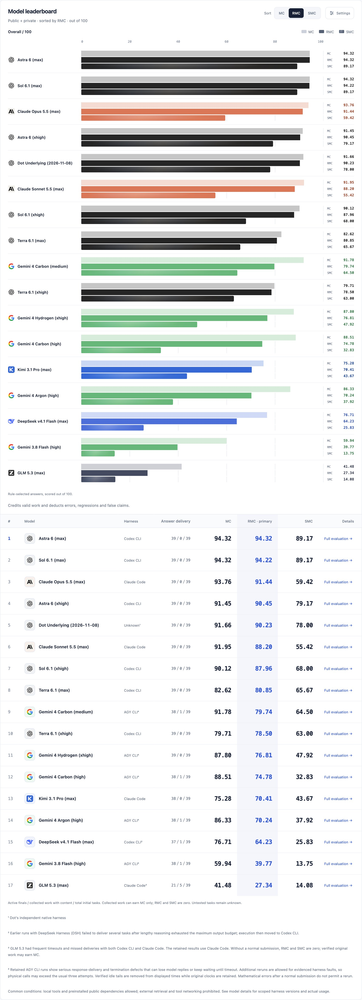
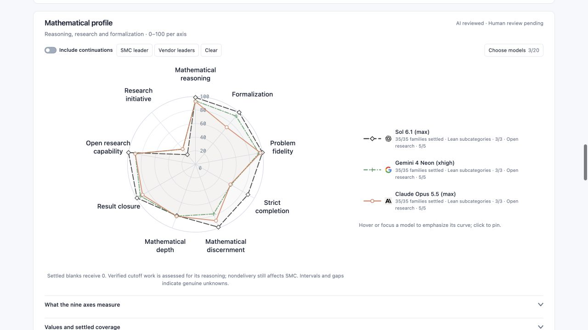

# Math Gauge

[简体中文](README.md) · [English](README.en.md)

**Measure the capability, not just the answer.**

Math Gauge evaluates models on mathematical work: written proofs, Lean formalization and mathematical research tasks. The current assessment edition is **[1.3.0](docs/scoring-guide.md#english)**; the latest published task distribution is **[1.0.0](https://github.com/glenzli/math-gauge/releases/tag/v1.0.0)**.

[Live leaderboard](https://glenzli.com/benchmarks/math-gauge/?lang=en) · [Full results](docs/results.md) · [Public tasks](cases/README.md) · [Harness guide](docs/harness-guide.md)

## Why I built Math Gauge

> The first analogy that came to my mind is of immersing the nut in some softening liquid, and why not simply water?
>
> (Alexander Grothendieck, *Récoltes et Semailles*, translated by Colin McLarty in [*The Rising Sea*](https://www.landsburg.com/grothendieck/mclarty1.pdf).)

I really like the phrase "soaking the nut."

Today's frontier models already have very strong mathematical abilities, and benchmarks such as [FrontierMath](https://epoch.ai/frontiermath) and [BrokenArXiv](https://matharena.ai/?comp=overall--brokenarxiv) offer useful points of reference. Yet while writing [OET (Operator Evolution Theory)](https://glenzli.com/books/oet/), I still run into problems: an argument can read smoothly but omit a necessary assumption, or an answer can look correct after quietly changing the question into something more familiar to the model.

Even an AI-assisted proof of the Riemann hypothesis (RH) has now passed [independent checks of both its statement and proof by the Lean and Mathlib communities](https://leanprover-community.github.io/blog/posts/riemann-hypothesis/). Against that backdrop, I see limited value in a benchmark that only keeps raising problem difficulty. I want to know how reliably, faithfully and rigorously a model can participate in actual mathematical work.

In my own mathematical work, I often start with an idea, then gradually clarify the concepts, find a useful representation and work through the derivations and proofs. Some of these ideas do not follow routes familiar to a model. I care about whether it can keep track of the original question, check each step carefully and preserve the assumptions and intent. It can challenge an idea, give a counterexample or suggest another approach, but it needs to explain its reasons and how that approach relates to the original problem.

Over the course of this work, I moved from mainly using Gemini and Claude to GPT models for most tasks. I gradually got a feel for their different strengths, blind spots and styles. But models keep improving, so those impressions need to be revisited. That gave me the idea for a benchmark tailored to my own mathematical work. I could turn the derivations, argument reviews, background checks and Lean formalization I need help with into tasks, compare what the models actually deliver, and use the results to choose my main model and decide how to divide the work. That is how Math Gauge began.

## What the suite tests

| Area | Points | Main tasks |
|---|---:|---|
| Written proof | 30 | Arguments, counterexamples, boundary analysis and review of existing arguments. |
| Lean | 30 | Semantic audits, formalization and three successive self-checks, assessing code, mathematical alignment and error correction. |
| Supporting research | 30 | Background checks, theorem extensions and developing an idea into a rigorous manuscript. |
| Independent open research | 10 | Three successive manuscripts in one research session, assessing mathematical taste, research capacity and self-review. |

The base suite has 39 initial tasks (25 public and 14 private) and three self-checks of one whole-chapter Lean project. Edition 1.3.0 adds one private independent research task with three manuscripts, bringing the total to **40 logical tasks, 36 mathematical families and 45 prescribed deliveries**. Each model’s selected neutral revisions are additional.

For a first example, read the [matrix-estimate idea-to-manuscript task](cases/manuscript-completion/MG-MCP003/task.md). The catalog and selection notes explain the subcategories and task choices. [Public tasks](cases/README.md) · [Selection rationale](docs/selection.md)

## Reading the scores

| Score | Meaning |
|---|---|
| **SMC · Strict Mathematical Completion** | Base tasks use whole-task or full three-round Lean acceptance. Independent open research counts strictly accepted net mathematical credit. |
| **RMC · Reliable Mathematical Capability** | Reliable mathematical work after deductions for false claims, misjudgments and related errors. |
| **MC · Mathematical Capability** | Verified positive mathematical contributions, including valid progress on unfinished tasks. |

All three scores use the same answers selected by the rules and a **100-point scale**. Unrun tasks retain unknown ranges. The base suite uses the first normal final allowed by the rules. If no normal final is submitted, verified original work present by the cutoff can earn MC, while RMC and SMC are zero.

A non-Lean base task gets one neutral revision when any of its three scores is confirmed below full credit. Each score then uses **80% of the first answer plus 20% of the revision**. Independent open research combines **mathematical taste and research capacity at 2:1** before entering the overall score. [Scoring guide](docs/scoring-guide.md#english) · [Revision protocol](protocol/neutral-revision.md)

## Current results

The 1.3.0 leaderboard lists **19 settled configurations**, ranks by SMC by default and includes category results, ten-axis profiles and historical editions. Adopted results use AI review with some human spot checks. Human mathematical review of the independent research is pending. [Full results](docs/results.md) · [Review process](docs/review-process.md)

A separate, collapsed [exploration-orientation portrait](protocol/exploration-orientation.md#exploration-orientation) follows the capability profile. It observes horizontal expansion, vertical deepening, structural reframing, boundary probing and experimental exploration across the same three-round research task. These describe choices in this task and add no overall score.

[](https://glenzli.com/benchmarks/math-gauge/?lang=en)

<details>
<summary>Cost and timing screenshots</summary>

Both plots use RMC. [Cost method](docs/cost-reference.md) · [Timing method](docs/answer-timings.md)

[](https://glenzli.com/benchmarks/math-gauge/?lang=en&cost-axis=cost&cost-score=partial#cost-frontier)

[](https://glenzli.com/benchmarks/math-gauge/?lang=en&cost-axis=time&cost-score=partial#cost-frontier)

</details>

<details>
<summary>Ten-axis mathematical profile</summary>

[](https://glenzli.com/benchmarks/math-gauge/?edition=1.3.0&lang=en#mathematical-profile)

</details>

## Viewing locally and running the assessment

From the repository root, start a local server and open <http://127.0.0.1:8000/site/>:

```bash
python3 -m http.server 8000 --bind 127.0.0.1
```

All formal tasks **allow local tools and preinstalled public dependencies**. External retrieval and tool networking are prohibited. Model-service and authentication traffic are recorded separately. [Harness and delivery guide](docs/harness-guide.md)

## Further reading

[Evaluation protocol](protocol/evaluation.md) · [Result-record contract](protocol/result-record.md) · [Edition guide](docs/edition-views.md) · [Evidence retention](docs/evidence-retention.md)
