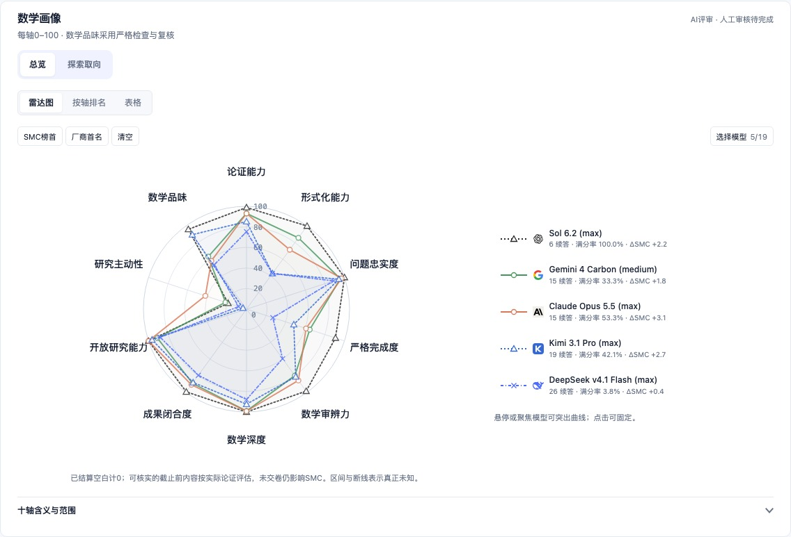

# Math Gauge

[简体中文](README.md) · [English](README.en.md)

**Measure the capability, not just the answer.**

Math Gauge 是一套面向数学工作的模型评测，涵盖书面证明、Lean 形式化和数学研究任务。当前评测版本为 **[1.3.0](docs/scoring-guide.md)**；最新已发布题包为 **[1.0.0](https://github.com/glenzli/math-gauge/releases/tag/v1.0.0)**。

[在线榜单](https://glenzli.com/benchmarks/math-gauge/?lang=zh) · [完整结果](docs/results.md) · [公开题目](cases/README.md) · [运行指南](docs/harness-guide.md)

## 为什么做 Math Gauge

> 我最先想到的比喻，是把核桃浸在某种能让它软化的液体里——为什么不干脆用水呢？
>
> （引自格罗滕迪克《收获与播种》，据 Colin McLarty〈[The Rising Sea](https://www.landsburg.com/grothendieck/mclarty1.pdf)〉所引英译转译。）

我很喜欢“泡核桃”这个表述。

现在的前沿模型，数学能力已经很强。[FrontierMath](https://epoch.ai/frontiermath)、[BrokenArXiv](https://matharena.ai/?comp=overall--brokenarxiv) 等评测，也为了解它们提供了很好的参考。不过，在编写 [OET（算子演化论）](https://glenzli.com/books/oet/) 的过程中，我还是会遇到一些问题：有的推导写得流畅，仔细检查却少了条件；有的回答看似正确，实际上已经把问题换成了模型更熟悉的样子。

连 RH（黎曼猜想）的 AI 辅助证明，也已通过 [Lean 与 Mathlib 社区对命题和证明的独立核验](https://leanprover-community.github.io/blog/posts/riemann-hypothesis/)。在这样的进展下，我觉得 benchmark 若只是不断提高题目难度，意义已经很有限；我更想知道模型能否稳定、忠实、严谨地参与实际数学工作。

在我自己的数学工作中，往往是先有一个想法，再慢慢理清概念、寻找合适的表示，把推导和证明展开。有些思路未必走在模型熟悉的套路上，我会更看重它能否跟住原来的问题，认真检查每一步，守住条件和意图。它可以质疑、举反例，也可以提出别的做法，但要把理由和与原问题的关系讲清楚。

这一路，我的主力也从早期的 Gemini、Claude 逐渐换成了 GPT 系列。使用中，我慢慢摸到了不同模型的强项、盲点和风格；但模型还在不断进步，过去的经验也需要更新。我于是想做一套贴近自己数学工作的 benchmark，把日常需要的推导、审阅、背景核查和 Lean 形式化整理成题，看各个模型实际做得怎样，再决定接下来选谁做主力、怎样分工。Math Gauge 就是这样来的。

## 测什么

| 方向 | 满分 | 主要任务 |
|---|---:|---|
| 书面证明 | 30 | 书面论证、反例与边界分析，以及对已有论证的审阅。 |
| Lean | 30 | 语义审计、形式化与连续三轮自查，分别检查代码、数学对应和纠错。 |
| 辅助研究 | 30 | 背景核查、命题拓展，以及把一个数学想法展开成严谨手稿。 |
| 独立开放研究 | 10 | 在同一研究会话中连续交付三稿，考察数学品味、研究能力和自审取舍。 |

基础题包含 39 道初答题（公开 25 道、私有 14 道）及同一道整章 Lean 题的三轮自查。加上 1.3.0 的私有独立研究三稿，共 **40 个逻辑任务、36 个数学家族、45 次规定交付**。各模型选定的中性续答另计。

可以从一道[矩阵估计想法的手稿化任务](cases/manuscript-completion/MG-MCP003/task.md)读起。题目目录附分项与选题依据。 [公开题目](cases/README.md) · [选题说明](docs/selection.md)

## 怎么读分数

| 分数 | 含义 |
|---|---|
| **SMC · Strict Mathematical Completion** | 基础题按整题或完整 Lean 三轮轨迹验收。独立开放研究计入经严格验收的净成果。 |
| **RMC · Reliable Mathematical Capability** | 在有效成果上扣除错误断言、误判等造成的损失，衡量可靠的数学成果。 |
| **MC · Mathematical Capability** | 只计经过核实的有效数学贡献，包括未完成任务中的有效进展。 |

三种分数使用同一批按规则选定的答卷，均以 **100 分为满分**，未测项保留未知范围。基础题采用规则内首次正常交卷。没有正常交卷时，MC 可计经核实的截止前原成果，RMC 与 SMC 为 0。

非 Lean 基础题中，任一分数确认未满的题续答一次，三种分数均按 **80% 首答＋20% 续答**折算。独立开放研究先按**数学品味与研究能力 2∶1**合成，再计入总分。 [规则与评分索引](docs/scoring-guide.md) · [续答规则](protocol/neutral-revision.md)

## 当前结果

1.3.0 榜单收录 **19 个已结算配置**，默认按 SMC 排序，并提供分类成绩、十轴数学画像和历史版本。已采用的结果经 AI 审核，另有部分人工抽审。独立开放研究的人工数学审核仍待完成。 [完整结果](docs/results.md) · [审核方式](docs/review-process.md)

数学画像内另有[探索取向](protocol/exploration-orientation.md)子项，与总览共用模型多选和高亮对照：从横向拓展、纵向深挖、结构重构、边界探查和实验探索，观察模型在同一三轮研究中的选择方式。它描述本次研究取向，不计总分。

[](https://glenzli.com/benchmarks/math-gauge/?lang=zh)

<details>
<summary>成本与耗时截图</summary>

两图的纵轴均为 SMC。 [成本口径](docs/cost-reference.md) · [计时口径](docs/answer-timings.md)

[](https://glenzli.com/benchmarks/math-gauge/?lang=zh&cost-axis=cost&cost-score=strict#cost-frontier)

[](https://glenzli.com/benchmarks/math-gauge/?lang=zh&cost-axis=time&cost-score=strict#cost-frontier)

</details>

<details>
<summary>十轴数学画像</summary>

[](https://glenzli.com/benchmarks/math-gauge/?edition=1.3.0&lang=zh#mathematical-profile)

</details>

## 本地查看与运行评测

在仓库根目录启动本地服务，再打开 <http://127.0.0.1:8000/site/>：

```bash
python3 -m http.server 8000 --bind 127.0.0.1
```

所有正式题目均**允许本地工具及预置公共依赖，禁止联网检索和工具联网**。模型服务与认证连接另行记录。 [运行与交付指南](docs/harness-guide.md)

## 继续阅读

[评测协议](protocol/evaluation.md) · [正式结果记录](protocol/result-record.md) · [版本说明](docs/edition-views.md) · [证据留存](docs/evidence-retention.md)
