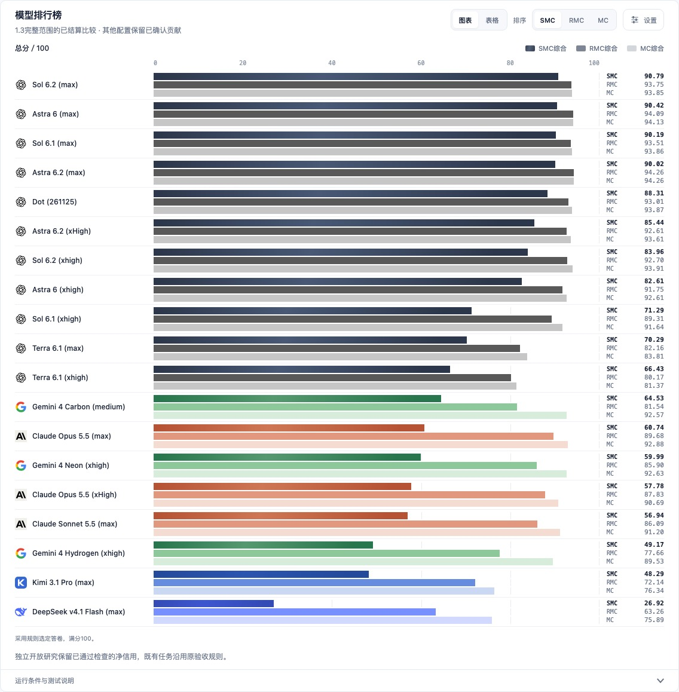
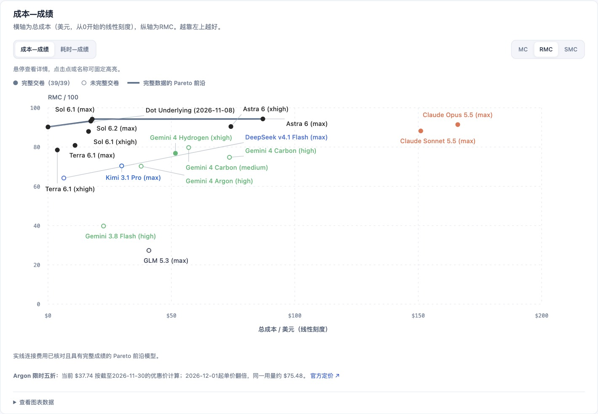

# Math Gauge

[简体中文](README.md) · [English](README.en.md)

**Measure the capability, not just the answer.**

Math Gauge 是一套面向数学工作的模型评测，涵盖书面证明、Lean 形式化和数学研究任务。当前评测版本为 **[1.3.0](docs/scoring-guide.md)**；最新已发布题包为 **[1.0.0](https://github.com/glenzli/math-gauge/releases/tag/v1.0.0)**。

[在线榜单](https://glenzli.com/benchmarks/math-gauge/?lang=zh) · [完整结果](docs/results.md) · [公开题目](cases/README.md) · [运行指南](docs/harness-guide.md)

## 为什么做 Math Gauge

> 我最先想到的比喻，是把核桃浸在某种能让它软化的液体里——为什么不干脆用水呢？
>
> （引自格罗滕迪克《收获与播种》，据 Colin McLarty〈[The Rising Sea](https://www.landsburg.com/grothendieck/mclarty1.pdf)〉所引英译转译。）

我很喜欢“泡核桃”这个表述。

现在的前沿模型，数学能力已经很强。[FrontierMath](https://epoch.ai/frontiermath)、[BrokenArXiv](https://matharena.ai/?comp=overall--brokenarxiv) 等评测，也为了解它们提供了很好的参考。不过，在编写 [OET（算子演化论）](https://glenzli.com/books/oet/) 的过程中，我还是会遇到一些问题：有的推导写得流畅，仔细检查却少了条件；有的回答看似正确，实际上已经把问题换成了模型更熟悉的样子。

连 RH（黎曼猜想）的 AI 辅助证明，也已通过 [Lean 与 Mathlib 社区对命题和证明的独立核验](https://leanprover-community.github.io/blog/posts/riemann-hypothesis/)。在这样的进展下，我觉得 benchmark 若只是不断提高题目难度，意义已经很有限；我更想知道模型能否稳定、忠实、严谨地参与实际数学工作。

在我自己的数学工作中，往往是先有一个想法，再慢慢理清概念、寻找合适的表示，把推导和证明展开。有些思路未必走在模型熟悉的套路上，我会更看重它能否跟住原来的问题，认真检查每一步，守住条件和意图。它可以质疑、举反例，也可以提出别的做法，但要把理由和与原问题的关系讲清楚。

这一路，我的主力也从早期的 Gemini、Claude 逐渐换成了 GPT 系列。使用中，我慢慢摸到了不同模型的强项、盲点和风格；但模型还在不断进步，过去的经验也需要更新。我于是想做一套贴近自己数学工作的 benchmark，把日常需要的推导、审阅、背景核查和 Lean 形式化整理成题，看各个模型实际做得怎样，再决定接下来选谁做主力、怎样分工。Math Gauge 就是这样来的。

## 测什么

| 方向 | 满分 | 主要任务 |
|---|---:|---|
| 书面证明 | 30 | 书面论证、反例与边界分析，以及对已有论证的审阅。 |
| Lean | 30 | 语义审计、形式化与连续三轮自查，分别检查代码、数学对应和纠错。 |
| 辅助研究 | 30 | 背景核查、命题拓展，以及把一个数学想法展开成严谨手稿。 |
| 独立开放研究 | 10 | 在同一研究会话中连续交付三稿，考察数学品味、研究能力和自审取舍。 |

基础题包有 **39 道初答题：公开 25 道、私有 14 道，共 35 个数学家族**，另有同一整章 Lean 题的三轮自查。1.3.0 再加入一道私有独立开放研究题，连续交付三稿，合计 **40 个逻辑任务、36 个数学家族、45 次规定交付**。各模型选定的非 Lean 中性续答另计。相关变体先在家族内聚合，公私共用运行与计分规则；已发布的 1.0.0 题包保持封版。

想先看一道题，可以从[矩阵估计想法的手稿化任务](cases/manuscript-completion/MG-MCP003/task.md)读起。各子类的题目、权重和选题理由见[题目目录](cases/README.md)与[选题说明](docs/selection.md)。候选只接收题面和明确提供的材料，参考与判准不进入答题上下文；私有题的题面、原答和逐题评审保持私有。

## 怎么读分数

| 分数 | 含义 |
|---|---|
| **SMC · Strict Mathematical Completion** | 基础题按整题或完整 Lean 三轮轨迹验收；独立开放研究保留经严格验收的净成果信用。各项按当前版本权重汇总。 |
| **RMC · Reliable Mathematical Capability** | 在有效成果上扣除错误断言、误判等造成的损失，衡量可靠的数学成果。 |
| **MC · Mathematical Capability** | 只计经过核实的有效数学贡献，包括未完成任务中的有效进展。 |

三种分数使用同一批规则选定答卷和固定权重，均按 **100 分**报告；未测项保留未知范围，不把已测部分放大到满分。每题采用规则内首次正常交卷；没有正常交卷时，MC 可计经核实的截止前原成果，RMC 与 SMC 为 0。1.2.0对非Lean失分题增加一次中性续答，入选整题的三个分数均按**80%首答＋20%续答**折算；三个分数首答全满的题免测，Lean结果沿用。首答与续答的严格判断分别保留，退步也按20%反映。具体见[续答规则](protocol/neutral-revision.md)与[评分规范](protocol/benchmark-scoring.md)。

1.3.0 将书面、Lean、辅助研究各调整为 30 分，独立开放研究占 10 分。新题先按 **数学品味∶研究能力＝2∶1** 合成，再计入总榜一次；SMC 不由通过检查的数量直接换算。完整公式、各子类标准和全部辅助指标见[规则与评分索引](docs/scoring-guide.md)。

命题拓展题另看实际研究增量：R1 是有用的局部推进，R2 是实质拓展，R3 是深入且完整的研究成果；同等分量的不同路线、证明内部的强结论都可计入。该子类的 SMC 要求原题正确并完整达到 R3。B2／R0 表示原题证明正确，只是没有研究增量。具体尺度见 [1.1.0 评分说明](docs/theorem-extension-reassessment.md)。

## 当前结果

榜单默认显示 **1.3.0**，按 SMC 排序，可切换 SMC／RMC／MC、分类成绩、模型详情和历史版本。当前已有 **17 个配置**完成独立开放研究三稿及审核；[完整结果](docs/results.md)列出总分与来源。Carbon medium 的新研究测试仍待结算，不借用其他模型的成绩。

| 模型（当前1.3节选） | SMC | RMC | MC |
|---|---:|---:|---:|
| Sol 6.2 (max) | 90.79 | 93.75 | 93.85 |
| Astra 6 (max) | 90.42 | 94.09 | 94.13 |
| Sol 6.1 (max) | 90.19 | 93.51 | 93.86 |

1.2.0 基底已结算 **18 个配置、221 份中性续答**，其中 107 份达到续答自身的三项满分。Carbon medium 的基底成绩为 **SMC 66.32／RMC 82.94／MC 94.01**。各模型续答自己的失分题，满分率不表示同题排名；基底成绩与增量继续单独保留。

当前提供十轴数学画像：除论证、忠实度、审辨、深度和闭合，还包括[数学品味](docs/open-research-v130.md)、[开放研究能力](docs/open-research.md)、[形式化能力](docs/formalization-profile.md)、严格完成度和[研究主动性](docs/research-initiative.md)。形式化使用 Lean 整体 SMC；主动性按 28 个共同机会独立评审。画像不另加到总分。内容可靠率、完整目标达成率与主动额外成果仍是首答诊断。

成本完整计入有效首答、Lean 自查、采用续答和独立研究的开销；耗时仍比较共有公开非 Lean 题，整章形式化单列。三稿研究的费用与耗时范围分别说明，见[成本口径](docs/cost-reference.md)和[计时口径](docs/answer-timings.md)。

GLM 5.3、Gemini 3.8 Flash 与 Gemini 4 Argon 不再纳入 1.2.0 及之后的当前名单；历史成绩、原答与评审保留。当前采用 **AI 审核，另有部分人工抽审**，各批次保留实际评审归属，新增独立研究的人工数学审核仍待完成。见[审核方式](docs/review-process.md)与[版本说明](docs/edition-views.md)。

[](https://glenzli.com/benchmarks/math-gauge/?lang=zh)

<details>
<summary>成本与耗时截图</summary>

以下两图为当前 1.3.0 的 RMC 视图。成本使用留档 API 参考价或测试日费用，完整计入已采用续答和独立开放研究；耗时比较共有公开非 Lean 题，包含工具使用与等待，受运行环境影响。来源与限制见[成本口径](docs/cost-reference.md)和[计时口径](docs/answer-timings.md)。

[](https://glenzli.com/benchmarks/math-gauge/?lang=zh&cost-axis=cost&cost-score=partial#cost-frontier)

[](https://glenzli.com/benchmarks/math-gauge/?lang=zh&cost-axis=time&cost-score=partial#cost-frontier)

</details>

<details>
<summary>十轴数学画像</summary>

画像包含数学品味、开放研究能力与研究主动性。形式化能力采用 Lean 整体 SMC，包含语义审计、工程形式化和三轮对齐自查。各轴使用对应审核来源，不另加到主榜分数。

[](https://glenzli.com/benchmarks/math-gauge/?edition=1.3.0&lang=zh#mathematical-profile)

</details>

## 本地查看与运行评测

在仓库根目录启动本地服务，再打开 <http://127.0.0.1:8000/site/>：

```bash
python3 -m http.server 8000 --bind 127.0.0.1
```

要运行评测，请按[运行与交付指南](docs/harness-guide.md)准备题包和独立答题环境。所有正式题目均 **允许本地工具及预置公共依赖，禁止联网检索和工具联网**；模型服务与认证连接另行记录。题包、时间限制、封卷、隔离和重试的具体要求都在指南中。

## 继续阅读

| 想了解 | 入口 |
|---|---|
| 题目与选题 | [公开题目](cases/README.md) · [选题说明](docs/selection.md) |
| 规则总览 | [逐项规则、公式与文档索引](docs/scoring-guide.md) · [独立开放研究](docs/open-research-v130.md) |
| 评分与审核 | [评测协议](protocol/evaluation.md) · [评分规范](protocol/benchmark-scoring.md) · [审核方式](docs/review-process.md) |
| 辅助指标 | [十轴数学画像](docs/scoring-guide.md#数学画像十轴) · [内容可靠率与目标达成率](protocol/content-rates.md) · [手稿主动额外成果](docs/manuscript-observations.md) |
| 执行与留档 | [运行与交付指南](docs/harness-guide.md) · [正式记录合同](protocol/result-record.md) |
| 时间与费用 | [计时口径](docs/answer-timings.md) · [成本口径](docs/cost-reference.md) |
| 故障与补测 | [答卷来源更正](docs/harness-corrections.md) · [整章自查补充](docs/c003-sealed-continuation.md) · [尝试与重试统计](docs/execution-attempts.md) |
| 版本与证据 | [1.1.0 评分说明](docs/theorem-extension-reassessment.md) · [1.0.0 发行说明](releases/v1.0.0/README.md) · [证据留存与恢复](docs/evidence-retention.md) |
