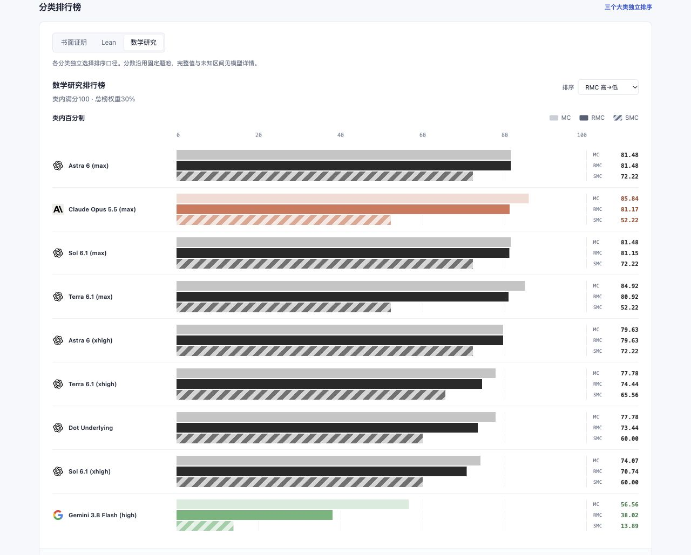

# Math Gauge

[简体中文](README.md) · [English](README.en.md)

**Measure the capability, not just the answer.**

Math Gauge 关心模型能否可靠地完成数学工作：理解给定结构，计算与证明，检查别人的论证，把自然语言目标落实为语义对应的 Lean 工程，并在自查时保持判断。

当前题包为 **benchmark 0.6.0 封版**，最新分发版为 **0.6.1**（[更新说明](releases/v0.6.1/README.md)）。保留0.6.0发行及原资产；本次更新页面、文档和已入库结果展示。AI 审核 / 人审待定，正式比较资格为 false。


## 排行榜预览




截图启用“仅显示已测完模型”，展示当前9个完成评测的模型；完成评测不代表全题正确。页面默认保留全部11个已选模型，未测完者以 * 标记。此开关只影响显示，不改分数、权重或固定分母。界面支持中文／English，分类、差值与两率图独立排序，语言和筛选都可随URL分享。

[打开静态榜单](site/index.html) · [方法与数据](site/method.html) · [本地预览方式](#本地查看)

## 设计理念

数学进展也来自找到让问题变得简单的空间、对象与语言。格罗滕迪克在《Récoltes et Semailles》中用浸泡坚果作比喻：让周围的理论逐渐成熟，直到坚硬的外壳可以打开。这里借用这种“泡核桃”的思路，寻找适合问题的数学结构；出处可见 Colin McLarty 的 [The Rising Sea](https://www.landsburg.com/grothendieck/mclarty1.pdf)，其中译引原手稿第 552–553 页。

这也影响了 Math Gauge 的判准。有效的短证、反例、商空间和替代表示都可以完成目标。转换空间时，需要说明对应关系，并证明所得结论确实回到原问题；假设、量词、定义域和结论强度仍是评审的依据。简化后的结论仍须由严格证明支撑，篇幅与参考路线本身不计功。

按照作者在[《AI，数学能力，与未来》](https://glenzli.com/notes/ai-mathematical-ability-and-the-future/)中的区分，**Lv1** 是在已知对象与规则下计算、执行和实现，**Lv2** 是在已有定义、公理、语言与问题框架内证明或反驳。两者不是难度等级；极难的计算、乃至前沿猜想的证明，也可能属于其中。

这一代 Math Gauge 选取与 OET 数学写作、审计和形式化工作有关的一部分 Lv1/Lv2 能力，考察它们能否达到一定程度的稳定：条件会不会在长论证中漂移，编译通过的声明是否证明了原命题，模型能否识别自己的缺口，以及能否主动核查背景和拓展命题。独立解决前沿未解问题不作为本题包的准入要求；成绩的解释范围限于这组任务，Lv3 提出有生产力的新问题与 Lv4 创造数学框架的能力仍待其他方式考察。

## 题包与分类

| 大类 | 子类 | 满分 | 公有题 | 私有题 | 聚合单位 |
|---|---|---:|---:|---:|---|
| 书面证明 35 | 书面论证 | 25 | 8 | 4 | 合并后12个数学家族 |
| | 论证审阅 | 10 | 4 | 0 | 4个被审阅论证的父家族 |
| Lean 35 | 语义审计 | 10 | 4 | 0 | 2个数学家族 |
| | 形式化 | 15 | 4 | 0 | 2个数学家族 |
| | 对齐自查 | 10 | 1题复用 | 0 | 同一92项题的固定三轮轨迹 |
| 数学研究 30 | 背景核查 | 10 | 2 | 2 | 4个数学家族，独立A1 |
| | 数学想法手稿化 | 10 | 1 | 4 | 5个数学家族（公1／私4），独立A1 |
| | 命题拓展 | 10 | 2 | 4 | 6个数学家族，仅无提示A1 |

默认共39道初答任务（公有25／私有14）、35个数学家族，另复用整章题做三轮Lean对齐自查。公私统一benchmark版本0.6.0，统一题池计分，仅标来源数量，不发布独立公有分数。原书面重复、中性与立场分支退出当前默认计划，原答与审核继续保留为来源证据。完整目录见[题库](cases/README.md)，本次书面14→8的取舍见[选题说明](docs/selection.md)。

数学研究共30分：命题拓展已加入6题（公2／私4），背景核查4题（公2／私2），只测无提示首答，任何情况下均不发研究邀请。数学想法手稿化组件0.5.0含1道公有题与4道私有题，五个家族等权分享10分。私有书面论证现为四题，与公有8题共12个家族；不重复取得研究分。第四道书面题新增至私有集，其他五道加强题未采用；PS001另按用户选择替换公开GR103。

公开手稿化题[MG-MCP003](cases/manuscript-completion/MG-MCP003/task.md)以给定CH1结构和矩阵估计想法为起点，考察能否整理出严格、自洽的数学稿。它是有明确方向的手稿化任务，充分深入且正确即可满分；不要求另创前沿理论，也不以OET路线为唯一答案。

## 当前结果

三种分数共用39题（公25／私14）、35个数学家族及书面35／Lean35／研究30权重，另固定三轮Lean自查，共42次规定交付。权重覆盖100／100，数学想法手稿化组件0.5.0含5个等权家族（公有1／私有4），仍分享10分；不将已测部分重新归一化。

SMC（Strict Mathematical Completion）为严格数学交付的展示简称；归档模式仍为 `strict`，原判定规则不变。

| 模型 | Harness | 数学能力 MC | **可靠数学能力 RMC（主分）** | 严格数学交付 SMC | 已测覆盖 |
| --- | --- | --- | --- | --- | --- |
| Astra 6 (max) | Codex CLI | 94.32 | 94.32 | 89.17 | 39/39 |
| Sol 6.1 (max) | Codex CLI | 94.32 | 94.22 | 89.17 | 39/39 |
| Claude Opus 5.5 (max) | Claude Code | 93.76 | 91.44 | 59.42 | 39/39 |
| Astra 6 (xhigh) | Codex CLI | 91.45 | 90.45 | 79.17 | 39/39 |
| Dot Underlying | Unknown<sup>1</sup> | 91.66 | 90.23 | 78.00 | 39/39 |
| Sol 6.1 (xhigh) | Codex CLI | 90.12 | 87.96 | 68.00 | 39/39 |
| Terra 6.1 (max) | Codex CLI | 87.65 | 86.45 | 65.67 | 39/39 |
| Terra 6.1 (xhigh) | Codex CLI | 79.71 | 78.50 | 63.00 | 39/39 |
| DeepSeek v4.1 Flash (max)* | Codex CLI<sup>2</sup> | 64.80 | 57.07 | 25.83 | 38/39 |
| Gemini 3.8 Flash (high) | AGY CLI | 62.32 | 48.42 | 13.75 | 39/39 |
| Gemini 4 Argon (high)* | AGY CLI | 36.01 | 32.17 | 17.92 | 23/39 |


共同条件：允许本地工具与预置公共依赖，禁止联网检索及工具联网。Harness具体版本按批次保留，见模型详情。 *尚未测完；表中为满分100下的已确认贡献，完整区间见报告。

¹ Dot原生独立运行方式。

² 使用DeepSeek Harness（DSH）时，多道题因推理过程过长、耗尽最大输出预算而未能交卷，因此改用Codex CLI执行。

主表采用 `nonlogical_retry_3` 的规则选定成绩：每题含首次最多3次有效模型尝试，采用首次正常交付。

Claude Opus 5.5 (max)通过Claude Code 2.1.303交付完整39道初答及三轮固定自查，MC 93.76／RMC 91.44／SMC 59.42；内容可靠率94.22%、完整目标达成率85.84%。四道形式化初答全部完成，C003从A1至R3均为92/92，但R1对父稿已有证明的错误定位使整段自查SMC不通过；这与最终工程完整分别记录。39道初答中37道实际使用工具、共338次。实际收集器按公有/私有批次分别为0.1.0/0.2.0；配置和事件已核查，无独立运行隔离探针。没有补跑；原答、原始日志及工程完整留档，人工审核待定。

[Opus完整档案](results/v0.6.0/claude-opus-5.5-max/20261109/README.md)。

Astra 6 (xhigh)完成39道初答及三轮固定自查，MC 91.45／RMC 90.45／SMC 79.17，内容可靠率98.68%、完整目标达成率87.36%。同题包、工具和时限下，本轮RMC比max低3.87分；主要失分为AHR02的核心误判、C003首答82/92及较低的拓展得分。C003三轮自查均达到92/92，诊断准确、无回归。

[Astra xhigh完整档案](results/v0.6.0/astra-6-xhigh/20261110/README.md)。

Astra 6 (max)完成39道初答及三轮固定自查，无重试；MC 94.32／RMC 94.32／SMC 89.17，内容可靠率100%、完整目标达成率90.92%。Lean四份初答及三轮自查全部通过。与同口径复核后的Sol Max相比，MC与SMC同分，RMC高0.10分，差异来自Sol一处附带断言。网络手稿的忠实性判定已按两答实际给出的逐节点算子及组织对应一并更正，原答与旧评保留。

[Astra完整档案](results/v0.6.0/astra-6-max/20261109/README.md)。

Sol两档均完成39道初答及三轮固定自查，各42次物理请求、无重试或系统排除。三种分数、分类分项、内容可靠率与目标达成率均已按相同政策入库；本批次使用Codex CLI 0.167.0-alpha.3.2，后端型号与effort回显缺失，按未知留存。

重跑备注：本批GP001、GR009、PS001、GR021各在第2次尝试正常交付；3道无交付项各保留3次失败摘要。采用首次正常交付，正常数学错误不能重跑；原始回复与历史计次保留。

DeepSeek本轮27份新答卷完成评审，另8份按预选清单继承；35份有数学评审，3道初答无最终交付计0，C003初答及三轮自查待补。当前确认MC 64.80／RMC 57.07／SMC 25.83；完整分母仍为100。新原答尚未做两率逐项目标补审，不继承旧答的可靠率或达成率。

首页所有成绩图统一按模型分行横向展示，数值在右侧对齐，组内留2像素间隙；MC浅色、RMC实色、SMC粗斜纹，共用基线且不加外框。书面证明、Lean、数学研究三个独立分榜使用原有类内百分制成绩；大类贡献表以模型为行，点击大类表头展开子类列。分榜与总榜共用答卷与固定分母，各图独立选择排序依据：三个分类各自选择MC／RMC／SMC，差值图选择RG／DG接近0优先，两率图选择可靠率／达成率高低排序；顶部口径只控制总榜及总分贡献。

首页将可靠差RG（RMC−MC）与交付差DG（SMC−MC）合并为每模型两条横条的差值图（RG实色、DG粗斜纹），图例统一标识口径，未测完模型以*标记，首页统一注明“尚未测完”，覆盖详情留在模型页。0表示无落差，须结合能力分阅读，RMC仍为主分。

另有[内容可靠率与目标达成率](protocol/content-rates.md)：前者核查实际内容是否正确且有论证支持，后者按题意验收完整独立成果。MC保留部分进展，SMC要求整题及规定轨迹全部达标。两率沿原类别与家族权重计算，当前共用697个承诺单元与149个完整目标；补审本身不重写原三项主分及原评。0.1.0旧细项覆盖率单独保留，首页简述新口径，区间及覆盖见详情。

MC只计有效数学成果；RMC为默认主分，普通错误承诺按题扣5%／10%／20%，同根去重、通用封顶20%；数学想法手稿化按独立组件政策将普通上限提高到50%，其他题不变。明确放行使核心论证失效的错误、错误否决正确核心论证，或作出错误实际架构认可，RMC该题最高0，SMC不通过。纯遗漏、诚实未完成与合法条件论述不追加处罚；错误内容及依赖错误的成果仍不计MC。

新增私有手稿家族按冻结的完整目标与必要证明验收；独立附带错误仍扣可靠分。具体判准见[评分规范](protocol/benchmark-scoring.md)。

GR021–023移出原10分独立补充断言可靠性，以(S−r)/90计算纯数学比例，旧可靠性损失单列并与新罚去重。原三轮Lean自查继续使用既有回退、误报规则；后续自查不回填形式化初答。

PS001按用户选择替换公开GR103，仍为8公／4私书面论证、12家族等权。Gemini 3.8 Flash只采用原始A1原评94/100、Strict不通过；独立再评不进入当前留档。Terra新Max A1为100/100、Strict通过，用时430.738秒，工具开放、实际0次命令；单射段的局部引用错误单独记录。DeepSeek本轮PS001为100/100，SMC通过。GR103原答、原审核和冻结计划保留为历史来源，不再进入当前聚合。

所有正式测试允许本地工具与预置公共依赖，禁止联网检索和工具联网；模型服务与认证连接另记。允许与实际使用分别记录。纯系统故障不占有效尝试，输出耗尽仍占一次；数学错误不能重跑。新批次的实际Lean交付按封卷源码编译并逐项审查；旧归档沿用已绑定的编译证据，旧输入、原答、自评和0.4.0审核不改写。

benchmark0.6.0封版；聚合0.8.0／MC0.2.0／Strict0.2.0，承诺扣罚组件0.1.0，选题组件0.3.0、书面替换组件0.1.0。AI审核、人审待定，正式比较资格false。

[排行榜](site/index.html) · [完整报告](docs/results.md) · [0.6.0发布说明](releases/v0.6.0/README.md) · [其他Harness运行指南](docs/harness-guide.md) · [评分规范](protocol/benchmark-scoring.md) · [留档合同](protocol/result-record.md)


## 本地查看

```bash
python3 -m http.server 8000 --bind 127.0.0.1
```

打开 `http://127.0.0.1:8000/site/`。中文截图视图为 `?lang=zh&complete=1`，英文为 `?lang=en&complete=1`；去掉 `complete=1` 显示全部模型。页面本身无需联网。重新生成页面使用 `python3 scripts/render_results_site.py`。

候选题包使用独立的[Harness指南](docs/harness-guide.md)。0.6.1分发保留 `benchmark-v0.6.0.zip` 的冻结题包身份；精确源提交及各资产散列见相应发行的 `release-lock.json`，不替换旧发行的同名资产。
