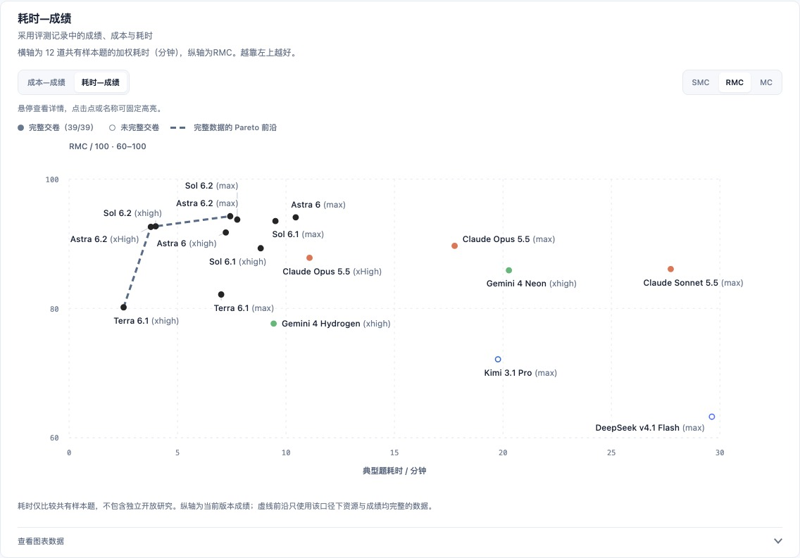

# Math Gauge

[简体中文](README.md) · [English](README.en.md)

**Measure the capability, not just the answer.**

Math Gauge 是一套面向数学工作的模型评测，涵盖书面证明、Lean 形式化和数学研究任务。当前评分版本为 **[1.2.0](docs/neutral-revision.md)**；最新已发布题包为 **[1.0.0](https://github.com/glenzli/math-gauge/releases/tag/v1.0.0)**。

[在线榜单](https://glenzli.com/benchmarks/math-gauge/?lang=zh) · [完整结果](docs/results.md) · [公开题目](cases/README.md) · [运行指南](docs/harness-guide.md)

## 为什么做 Math Gauge

> 我最先想到的比喻，是把核桃浸在某种能让它软化的液体里——为什么不干脆用水呢？
>
> （引自格罗滕迪克《收获与播种》，据 Colin McLarty〈[The Rising Sea](https://www.landsburg.com/grothendieck/mclarty1.pdf)〉所引英译转译。）

我很喜欢“泡核桃”这个表述。

现在的前沿模型，数学能力已经很强。[FrontierMath](https://epoch.ai/frontiermath)、[BrokenArXiv](https://matharena.ai/?comp=overall--brokenarxiv) 等评测，也为了解它们提供了很好的参考。不过，在编写 [OET（算子演化论）](https://glenzli.com/books/oet/) 的过程中，我还是会遇到一些问题：有的推导写得流畅，仔细检查却少了条件；有的回答看似正确，实际上已经把问题换成了模型更熟悉的样子。

在我自己的数学工作中，往往是先有一个想法，再慢慢理清概念、寻找合适的表示，把推导和证明展开。有些思路未必走在模型熟悉的套路上，我会更看重它能否跟住原来的问题，认真检查每一步，守住条件和意图。它可以质疑、举反例，也可以提出别的做法，但要把理由和与原问题的关系讲清楚。

这一路，我的主力也从早期的 Gemini、Claude 逐渐换成了 GPT 系列。使用中，我慢慢摸到了不同模型的强项、盲点和风格；但模型还在不断进步，过去的经验也需要更新。我于是想做一套贴近自己数学工作的 benchmark，把日常需要的推导、审阅、背景核查和 Lean 形式化整理成题，看各个模型实际做得怎样，再决定接下来选谁做主力、怎样分工。Math Gauge 就是这样来的。

## 测什么

| 方向 | 满分 | 主要任务 |
|---|---:|---|
| 书面证明 | 35 | 书面论证、反例与边界分析，以及对已有论证的审阅。 |
| Lean | 35 | 语义审计、形式化与连续三轮自查，分别检查代码、数学对应和纠错。 |
| 数学研究 | 30 | 背景核查、命题拓展，以及把一个数学想法展开成严谨手稿。 |

完整评测有 **39 道初答题：公开 25 道、私有 14 道，共 35 个数学家族**。同一整章 Lean 题另接续三轮自查，合计 42 次规定交付；相关变体先在家族内聚合，公私题共用运行与计分规则。

想先看一道题，可以从[矩阵估计想法的手稿化任务](cases/manuscript-completion/MG-MCP003/task.md)读起。各子类的题目、权重和选题理由见[题目目录](cases/README.md)与[选题说明](docs/selection.md)。候选只接收题面和明确提供的材料，参考与判准不进入答题上下文；私有题的题面、原答和逐题评审保持私有。

## 怎么读分数

| 分数 | 含义 |
|---|---|
| **SMC · Strict Mathematical Completion** | 每次交付按整题是否满足全部实质要求二值验收；1.2.0对首答和续答的判断加权。Lean自查按完整三轮轨迹验收。 |
| **RMC · Reliable Mathematical Capability** | 在有效成果上扣除错误断言、误判等造成的损失，衡量可靠的数学成果。 |
| **MC · Mathematical Capability** | 只计经过核实的有效数学贡献，包括未完成任务中的有效进展。 |

三种分数使用同一批规则选定答卷和固定权重，均按 **100 分**报告；未测项保留未知范围，不把已测部分放大到满分。每题采用规则内首次正常交卷；没有正常交卷时，MC 可计经核实的截止前原成果，RMC 与 SMC 为 0。1.2.0对非Lean失分题增加一次中性续答，入选整题的三个分数均按**80%首答＋20%续答**折算；三个分数首答全满的题免测，Lean结果沿用。首答与续答的严格判断分别保留，退步也按20%反映。具体见[续答规则](protocol/neutral-revision.md)与[评分规范](protocol/benchmark-scoring.md)。

命题拓展题另看实际研究增量：R1 是有用的局部推进，R2 是实质拓展，R3 是深入且完整的研究成果；同等分量的不同路线、证明内部的强结论都可计入。该子类的 SMC 要求原题正确并完整达到 R3。B2／R0 表示原题证明正确，只是没有研究增量。具体尺度见 [1.1.0 评分说明](docs/theorem-extension-reassessment.md)。

## 当前结果

榜单默认按 SMC 排序，指标依次为 SMC／RMC／MC。结果页面默认显示 **1.2.0**，本地已纳入完成续答的15个配置（GPT、Claude、Kimi和DeepSeek）；其他配置待回交，可查看 **1.1.0／1.0.0** 原成绩。模型页、逐题评审和下载跟随选版，详见[版本切换](docs/edition-views.md)。打开[在线榜单](https://glenzli.com/benchmarks/math-gauge/?lang=zh)，可以切换三种分数、查看分项，并从模型页进入公开原答与逐题评审；[完整文字结果](docs/results.md)保留成绩表、来源更正和补测说明。

15个配置共采用171份续答，其中100份达到续答自身的三项满分。原9个GPT配置的68份续答保留原记录，Claude三个配置与Kimi的68份回交答卷已经采用；另加入Astra 6.2 xHigh的9份续答，8份达到续答自身三项满分。全部171份续答均已完成AI数学审核。余下6个外部配置的106题等待回交，GLM跳过。成本计入有效续答的完整开销，耗时仍采用12道共有计时的题目，并单列整章形式化；数学画像可切换首答与含续答。原答、历史成绩和已发布1.0.0题包保留。这些更新目前在本地，下列各批次分别注明首答与续答评分口径。[新版说明](docs/neutral-revision.md)

DeepSeek v4.1 Flash（1017，max）的26道中性续答已结算：24份正常交卷、1份截止原稿仅计MC、1题截止无正文。1.2.0成绩为 **MC76.93／RMC64.09／SMC26.25**，续答自身三项满分1／26。新增参考成本$8.45，连同首答及三轮自查合计$14.86。原final、补回的原始交付附件、判分与130项独立五轴判断均已绑定来源；未新增作答。[详细审核](results/edition-reassessments/v1.2.0/deepseek-v4.1-flash-1017/20261110/REPORT.md)

2026-11-20 的 [Astra 6.2 (xHigh)](https://glenzli.com/benchmarks/math-gauge/models/astra-6.2-xhigh/?lang=zh) 已完成39道初答、三轮自查和9道中性续答。1.2.0成绩为SMC **83.90**、RMC **91.66**、MC **92.66**；原答和原评保持不变，运行来源为Codex CLI0.169.1／OpenAI API，人工数学审核仍待完成。分项、配套指标和运行条件见[完整结果](docs/results.md#astra-62-xhigh--2026-11-20)。

2026-11-19 的 [Claude Opus 5.5 (xHigh)](https://glenzli.com/benchmarks/math-gauge/models/claude-opus-5.5-xhigh/?lang=zh) 经 Sol 6.1 Max 并行全审，MC **91.36**、RMC **88.80**、SMC **54.92**。39道初答及三轮自查全部正常交付；逐项依据与运行条件见[完整结果](docs/results.md#claude-opus-55-xhigh--2026-11-19)。

2026-11-19 的 [Astra 6.2 Max](https://glenzli.com/benchmarks/math-gauge/models/astra-6.2-max/?lang=zh) 已完成39道初答和三轮自查。与 Astra 6 原答对照复核后，按1.1.0标准计为 MC **92.25**、RMC **92.25**、SMC **87.17**。分项、两率、数学画像和运行条件见[完整结果](docs/results.md#astra-62-max--2026-11-19)；Sol 6.2 Max／xHigh 的结果及前代对比也保留在其中。

数学画像另将[开放研究能力与研究主动性](docs/open-research.md)分开：前者看明确要求研究时交出了什么，后者看未被要求时是否自行推进，放在八轴最后。两者独立评审，不把克制直接解释为能力不足。

下图为1.1.0留档示意；当前1.2.0成绩与待补测状态以交互页为准。

[](https://glenzli.com/benchmarks/math-gauge/?lang=zh)

当前结果汇集不同批次的留档答卷，部分含旧答复用和后续补测；采用 **AI 审核，另有部分人工抽审**。实际运行条件、故障与重试经过随来源保留，阅读模型差异时可一并查看[审核方式](docs/review-process.md)和[运行记录](docs/results.md#记录与复算)。

<details>
<summary>成本与耗时截图</summary>

以下两图以 RMC 为例。基础成本计每题采用的一次作答及三轮固定自查；1.2.0另加实际采用续答的完整成本。截图为续答前留档，当前数值以交互页为准。成本使用留档的 API 参考价或测试日费用；耗时包含工具使用与等待，受运行环境影响。两者的来源和限制分别见[成本口径](docs/cost-reference.md)与[计时口径](docs/answer-timings.md)。

[](https://glenzli.com/benchmarks/math-gauge/?lang=zh&cost-axis=cost&cost-score=partial#cost-frontier)

[](https://glenzli.com/benchmarks/math-gauge/?lang=zh&cost-axis=time&cost-score=partial#cost-frontier)

</details>

## 本地查看与运行评测

在仓库根目录启动本地服务，再打开 <http://127.0.0.1:8000/site/>：

```bash
python3 -m http.server 8000 --bind 127.0.0.1
```

要运行评测，请按[运行与交付指南](docs/harness-guide.md)准备题包和独立答题环境。所有正式题目均 **允许本地工具及预置公共依赖，禁止联网检索和工具联网**；模型服务与认证连接另行记录。题包、时间限制、封卷、隔离和重试的具体要求都在指南中。

## 继续阅读

| 想了解 | 入口 |
|---|---|
| 题目与选题 | [公开题目](cases/README.md) · [选题说明](docs/selection.md) |
| 评分与审核 | [评测协议](protocol/evaluation.md) · [评分规范](protocol/benchmark-scoring.md) · [审核方式](docs/review-process.md) |
| 辅助指标 | [数学画像：首答／含续答](docs/mathematical-profile-revision.md) · [内容可靠率与目标达成率](protocol/content-rates.md) · [手稿主动额外成果](docs/manuscript-observations.md) |
| 执行与留档 | [运行与交付指南](docs/harness-guide.md) · [正式记录合同](protocol/result-record.md) |
| 时间与费用 | [计时口径](docs/answer-timings.md) · [成本口径](docs/cost-reference.md) |
| 故障与补测 | [答卷来源更正](docs/harness-corrections.md) · [整章自查补充](docs/c003-sealed-continuation.md) · [尝试与重试统计](docs/execution-attempts.md) |
| 版本与证据 | [1.1.0 评分说明](docs/theorem-extension-reassessment.md) · [1.0.0 发行说明](releases/v1.0.0/README.md) · [证据留存与恢复](docs/evidence-retention.md) |
