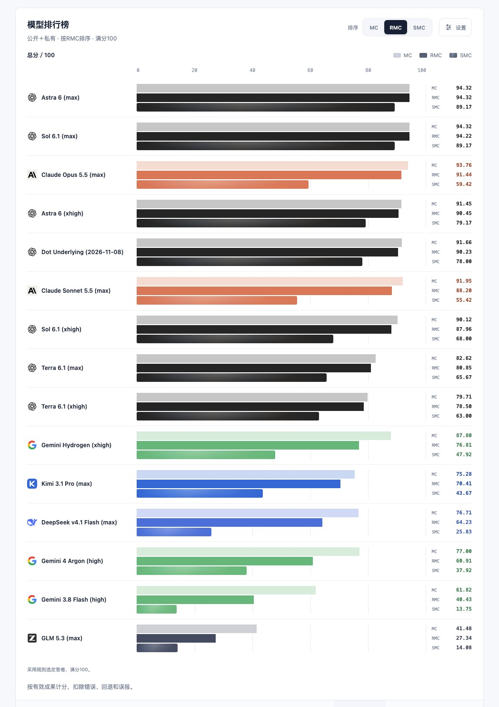
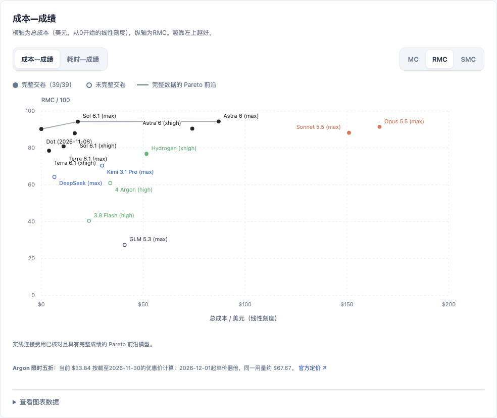
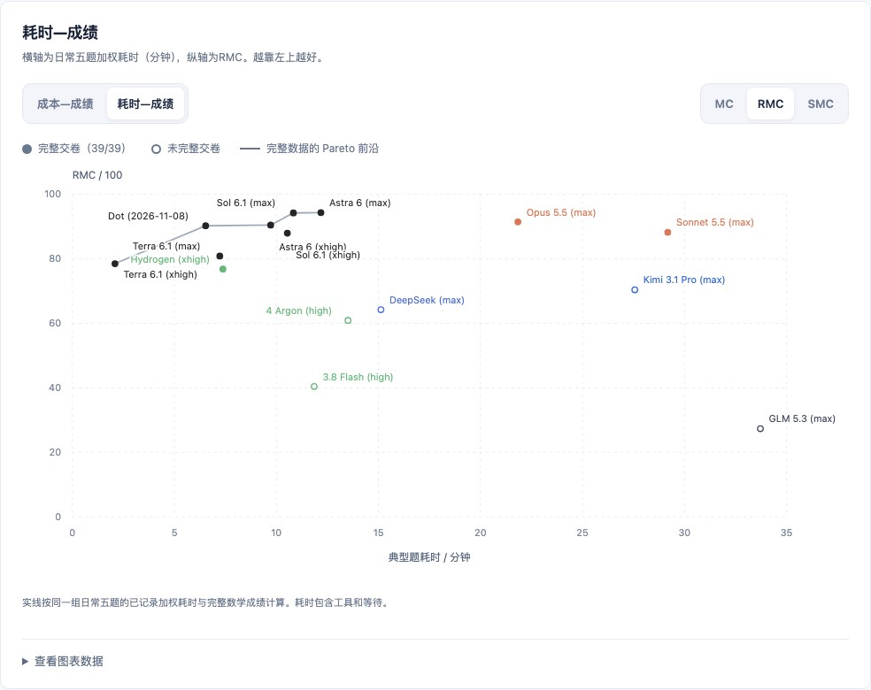

# Math Gauge

[简体中文](README.md) · [English](README.en.md)

**Measure the capability, not just the answer.**

Math Gauge 衡量模型能否可靠地完成数学工作：证明与反驳，审阅论证，将自然语言目标落实为语义对应的 Lean 工程，以及核查研究背景、拓展命题和把想法写成严格手稿。

当前正式版本为 **benchmark 1.0.0**。公有与私有题库组成同一套评测，共用运行器和评分规则。本版复用已留档的0.6答卷，原始运行身份、答卷和审核记录保持不变；[发行说明](releases/v1.0.0/README.md)记录兼容关系。

[排行榜](site/index.html) · [完整结果](docs/results.md) · [题库目录](cases/README.md) · [运行指南](docs/harness-guide.md)

## 设计理念

数学进展也来自找到让问题变得简单的空间、对象与语言。格罗滕迪克在《Récoltes et Semailles》中用浸泡坚果作比喻：让周围的理论逐渐成熟，直到坚硬的外壳可以打开。Math Gauge 借用这种“泡核桃”的思路，重视发现适合问题的结构。出处可见 Colin McLarty 的 [The Rising Sea](https://www.landsburg.com/grothendieck/mclarty1.pdf)，其中译引原手稿第 552–553 页。

有效的短证、反例、商空间和替代表示都可以完成目标。转换空间时，要证明对应关系，并将结论带回原问题；假设、量词、定义域与结论强度都须保留。严谨、自洽且忠实于题意的不同路线可以得满分，篇幅与参考路线本身不计功。

按照作者在[《AI，数学能力，与未来》](https://glenzli.com/notes/ai-mathematical-ability-and-the-future/)中的区分，**Lv1** 是在已知对象与规则下计算、执行和实现，**Lv2** 是在已有定义、公理、语言与问题框架内证明或反驳。两者描述工作类型；极难的计算与证明也可能属于其中。

这一代题包围绕 OET 数学写作、审计与形式化工作，验证一部分 Lv1/Lv2 能力能否稳定使用：长论证中条件是否漂移，形式化是否真正证明了原命题，自查能否发现并修好缺口，研究背景里的错误是否会被继续放大。独立解决前沿未解问题不作为本题包的要求。提出有生产力的新问题、创造数学框架，需要其他方式进一步考察。

## 题包结构

| 大类 | 子类 | 分值 | 公有题 | 私有题 | 聚合单位 |
|---|---|---:|---:|---:|---|
| 书面证明 · 35 | 书面论证 | 25 | 8 | 4 | 12 个数学家族 |
| | 论证审阅 | 10 | 4 | 0 | 4 个父家族 |
| Lean · 35 | 语义审计 | 10 | 4 | 0 | 2 个数学家族 |
| | 形式化 | 15 | 4 | 0 | 2 个数学家族 |
| | 对齐自查 | 10 | 复用 1 题 | 0 | 92 项整章题的固定三轮轨迹 |
| 数学研究 · 30 | 背景核查 | 10 | 2 | 2 | 4 个数学家族 |
| | 数学想法手稿化 | 10 | 1 | 4 | 5 个数学家族 |
| | 命题拓展 | 10 | 2 | 4 | 6 个数学家族 |

共 **39 道初答任务：公有 25／私有 14，涵盖 35 个数学家族**。另对同一整章 Lean 工程连续自查三轮，共 42 次规定交付。相关变体先在家族内聚合；公私合并计入固定的 100 分。

书面题考察证明、边界与反例；Lean 题逐步扩展到半章、整章规模，分别检验内核通过、语义对应和持续自查；研究题要求主动核查背景、尝试拓展或严格化给定想法。公开示例 [MG-MCP003](cases/manuscript-completion/MG-MCP003/task.md)从矩阵估计想法出发，要求交付完整的数学手稿。

公有题便于复现与检查，私有题补充未公开的数学任务。候选者只接收题面与明确提供的材料；私有参考、判准、原答和逐项评审保存在私库，公开结果仅展示其合并贡献。选题取舍见[选题说明](docs/selection.md)。

## 如何读分数

| 指标 | 衡量什么 |
|---|---|
| **MC · 数学能力** | 有效数学成果的正向贡献；无正常交卷时，可审核截止前经核实的原成果。 |
| **RMC · 可靠数学能力** | 在有效成果上扣除错误承诺、误判等损失，是默认主分。 |
| **SMC · 严格数学交付** | 按整题目标验收；Lean 自查还要求固定三轮轨迹满足完整性、诊断与无回退要求。 |

当前聚合0.9.0／MC0.3.0／SMC0.2.0，另绑提交来源0.1.0。三项分数采用同一组规则选定答卷、家族与权重。错误成果不得按“完成了”计分；编译通过也须另审是否对齐原数学目标。诚实地报告未完成，与错误宣称完整，会产生不同的可靠性结果。

另有[内容可靠率与完整目标达成率](protocol/content-rates.md)：前者检查实际交付内容的正确性与论证支持，后者验收题目要求的完整独立成果。数学研究分榜下的[主动额外成果观察](docs/manuscript-observations.md)记录经核实的、原任务未要求的成果组数，单独展示，不计入主分。目前覆盖 15 个模型的 72／75 个手稿槽。

## 当前总榜

下表按 RMC 排序，所有分数均在固定满分 100 下报告。允许的重跑按规则采用首次正常交付，来源与过程见各模型档案；部分测试继承了条件一致的既有答卷。

| 模型 | Harness | MC | **RMC（主分）** | SMC | 主动／强收／总题数 |
|---|---|---:|---:|---:|---:|
| [Astra 6 (max)](site/models/astra-6-max/index.html) | Codex CLI | 94.32 | 94.32 | 89.17 | 39／0／39 |
| [Sol 6.1 (max)](site/models/sol-6.1-max/index.html) | Codex CLI | 94.32 | 94.22 | 89.17 | 39／0／39 |
| [Claude Opus 5.5 (max)](site/models/claude-opus-5.5-max/index.html) | Claude Code | 93.76 | 91.44 | 59.42 | 39／0／39 |
| [Astra 6 (xhigh)](site/models/astra-6-xhigh/index.html) | Codex CLI | 91.45 | 90.45 | 79.17 | 39／0／39 |
| [Dot Underlying (2026-11-08)](site/models/dot-underlying-model-20261108/index.html) | Dot native harness¹ | 91.66 | 90.23 | 78.00 | 39／0／39 |
| [Claude Sonnet 5.5 (max)](site/models/claude-sonnet-5.5-max/index.html) | Claude Code | 91.95 | 88.20 | 55.42 | 39／0／39 |
| [Sol 6.1 (xhigh)](site/models/sol-6.1-xhigh/index.html) | Codex CLI | 90.12 | 87.96 | 68.00 | 39／0／39 |
| [Terra 6.1 (max)](site/models/terra-6.1-max/index.html) | Codex CLI | 82.62 | 80.85 | 65.67 | 39／0／39 |
| [Terra 6.1 (xhigh)](site/models/terra-6.1-xhigh/index.html) | Codex CLI | 79.71 | 78.50 | 63.00 | 39／0／39 |
| [Gemini Hydrogen (xhigh)](site/models/gemini-4-hydrogen-xhigh/index.html) | AGY CLI⁴ | 87.80 | 76.81 | 47.92 | 39／0／39 |
| [Kimi 3.1 Pro (max)](site/models/kimi-3.1-pro-max/index.html) | Claude Code | 75.28 | 70.41 | 43.67 | 38／0／39 |
| [DeepSeek v4.1 Flash (max)](site/models/deepseek-v4.1-flash-1017/index.html) | Codex CLI² | 76.71 | 64.23 | 25.83 | 37／1／39 |
| [Gemini 4 Argon (high)](site/models/gemini-4-argon/index.html) | AGY CLI⁴ | 77.00 | 60.91 | 37.92 | 38／1／39 |
| [Gemini 3.8 Flash (high)](site/models/gemini-3.8-flash-high/index.html) | AGY CLI⁴ | 61.82 | 40.43 | 13.75 | 38／1／39 |
| [GLM 5.3 (max)](site/models/glm-5.3-max/index.html) | Claude Code³ | 41.48 | 27.34 | 14.08 | 21／5／39 |

逐轮来源和完整分数区间见模型详情。主动交卷与强收有内容互斥；无正常交卷时RMC／SMC为0，MC可审核原成果。

¹ Dot 原生独立运行方式。

² 使用 DeepSeek Harness（DSH）时，多道题因推理过程过长、耗尽最大输出预算而未能交卷，因此改用 Codex CLI。

³ GLM 5.3 在 Codex CLI 和 Claude Code 中均出现大量超时；留档采用 Claude Code。无正常交卷时RMC／SMC为0，MC仅计经核实的截止原成果；三轮自查未执行。

⁴ AGY CLI留档中发现较严重的回传与终态处理缺陷，可能丢失模型回复或空等至超时。此类故障允许额外重跑，实际调用次数可能超过通常3次；已核实的末尾空等从展示耗时扣除，原始记录保留。正常交卷后不因数学错误重跑。

HCH02因AGY回传故障恢复的原答已按既有规则补审计入，原始ERROR和旧成绩保留；benchmark1.0.0与评分方法不变，见[故障更正说明](docs/harness-corrections.md)。

当前结果由 AI 评审并有部分人工抽审：Sol 6.1 Max 全审，Astra 6 Max 与 Dot 抽审核对。具体审核身份、证据与局限见[审核方式](docs/review-process.md)，逐模型分析见[结果报告](docs/results.md)。







两张前沿图默认使用RMC：总成本采用从0开始的线性美元刻度，典型题耗时以分钟计。实心点表示39道初答均正常交卷，其余为空心；颜色对应模型品牌。耗时包含工具与等待，受Harness、网络和硬件影响，见[计算方式与来源](docs/answer-timings.md)。

成本每题只计留档采用的尝试，其他重试不计。Dot使用测试日订阅附赠的独立额度，额外费用为$0；有可核实单价的模型按公开API价格折算并计缓存优惠。Hydrogen通过AGY订阅运行，按官方Standard API价格与42份原生用量折算为$51.63。Argon的$33.84为截至2026-11-30的限时五折价；12月起相同用量约$67.67。完整用量、价格与来源见[成本说明](docs/cost-reference.md)，[交互图表](site/index.html#cost-frontier)可切换分数与横轴。

排行榜发布测试流程已结束并选定留档的结果；后续测试结算后再上榜。[交互页面](site/index.html)提供分类榜、两率、分数落差、独立成本和耗时排序，支持切换MC／RMC／SMC、中英文及URL分享。模型页保留逐题结果、自查执行状态和分数区间。

## 运行与复现

所有正式题目均允许本地工具与预置公共依赖，禁止联网检索和工具联网；模型服务与认证连接单独记录。独立初答可以并行；同一 C003 工程的三轮自查须依次承接上一轮。答卷格式、时限、封卷、隔离、失败与重跑规则统一见[其他 Harness 运行指南](docs/harness-guide.md)。

在仓库根目录运行以下命令后，打开 <http://127.0.0.1:8000/site/> 即可本地查看静态榜单：

```bash
python3 -m http.server 8000 --bind 127.0.0.1
```

页面本身无需联网。页面重建与数据复算方式见[结果报告](docs/results.md)。

当前原答、审核、数学源码和时间／费用摘要保留在工作树；重复副本、原始大包、完整事件流与编译缓存通过固定 Git 提交和散列索引留存。公私库采用同一套[证据留存与恢复规则](docs/evidence-retention.md)，完整审计须保留 Git 历史。

## 文档

| 内容 | 入口 |
|---|---|
| 题型与选题 | [题库目录](cases/README.md) · [选题说明](docs/selection.md) |
| 执行与外部 Harness | [统一运行指南](docs/harness-guide.md) · [评测协议](protocol/evaluation.md) |
| 评分与留档 | [评分规范](protocol/benchmark-scoring.md) · [正式结果合同](protocol/result-record.md) · [证据恢复](docs/evidence-retention.md) |
| 结果与附加指标 | [完整结果](docs/results.md) · [两率](protocol/content-rates.md) · [额外成果观察](docs/manuscript-observations.md) |
| 发行与复现包 | [1.0.0 发行说明](releases/v1.0.0/README.md) · [0.6.1 分发说明](releases/v0.6.1/README.md) · [0.6.0 封版说明](releases/v0.6.0/README.md) |

1.0.0记录当前题包与评分口径；0.6.0题包及已发布资产保持冻结。分发版、执行组件与评分方法分别记录版本和来源。
