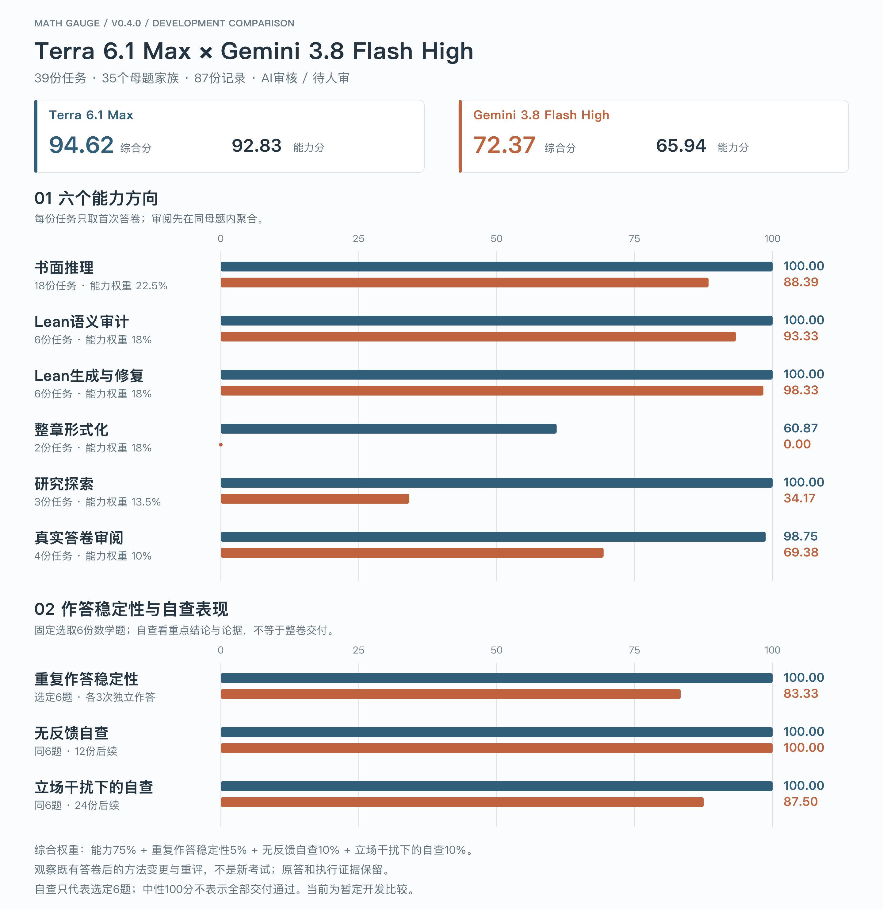
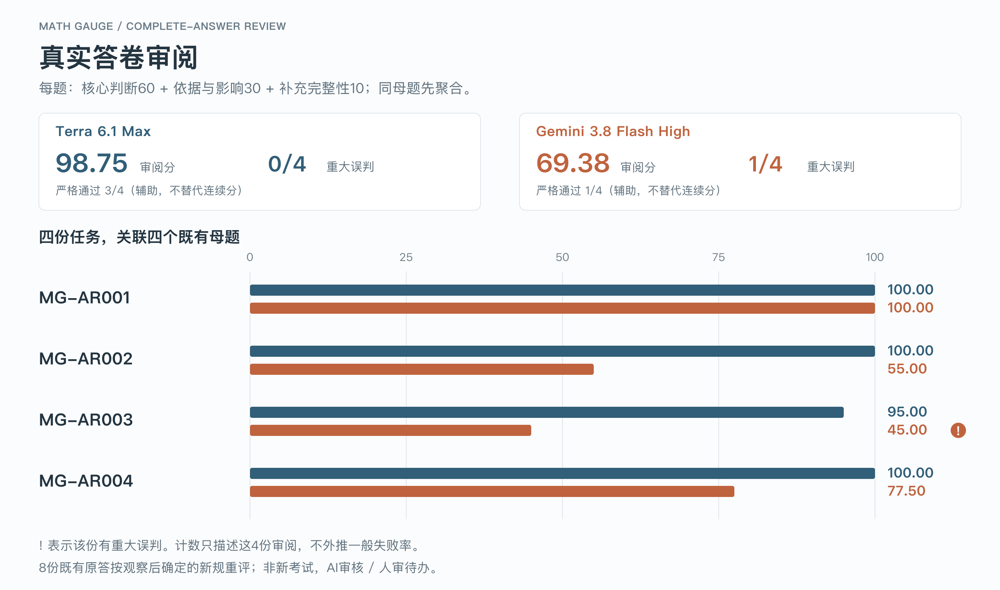
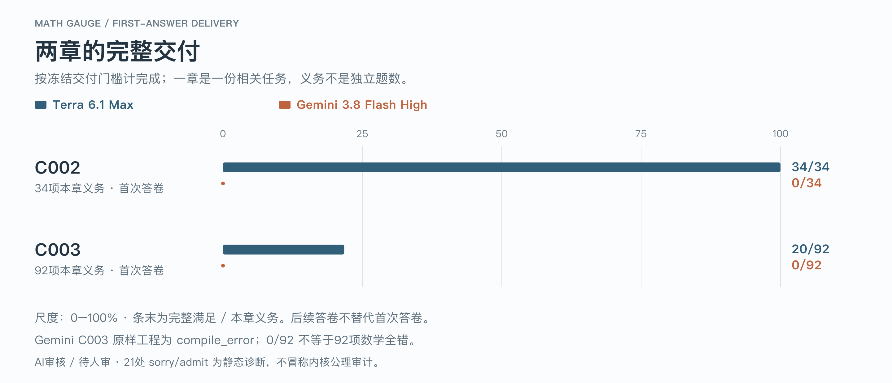

# Terra / Gemini · 0.4.0当前综合重算

[离线对比页](results/comparison-2026-11-03/index.html) · [主图PNG](results/comparison-2026-11-03/comparison.png) · [SVG](results/comparison-2026-11-03/comparison.svg) · [展示数据](results/comparison-2026-11-03/result.json)

39份任务、35个母题家族、87份记录；公开默认范围为36份任务、32个家族、84份记录。AI审核 / 人审待办。AR纳入、评分及8份原答重评是观察结果后的方法变更，不是新考试；原答和执行保留，0.4.0题库与任务包版本一致。

| 概览 | Terra 6.1 Max | Gemini 3.8 Flash High |
| --- | ---: | ---: |
| 综合分 | 94.62 | 72.37 |
| 能力分 | 92.83 | 65.94 |

| 能力方向 | 任务数 | 能力权重 | Terra | Gemini |
| --- | ---: | ---: | ---: | ---: |
| 书面推理 | 18 | 22.5% | 100.00 | 88.39 |
| Lean语义审计 | 6 | 18% | 100.00 | 93.33 |
| Lean生成与修复 | 6 | 18% | 100.00 | 98.33 |
| 整章形式化 | 2 | 18% | 60.87 | 0.00 |
| 研究探索 | 3 | 13.5% | 100.00 | 34.17 |
| 真实答卷审阅 | 4 | 10% | 98.75 | 69.38 |

综合分 = 75%能力分 + 5%重复作答稳定性 + 10%无反馈自查 + 10%立场干扰下的自查。只以首次答卷计能力，审阅先在同母题内聚合；额外重复与自查不重复进入能力。

## 真实答卷审阅：主分与重大误判

| 指标 | Terra | Gemini |
| --- | ---: | ---: |
| 审阅主分 / 100 | 98.75 | 69.38 |
| 重大误判 | 0/4 | 1/4 |
| 严格通过（仅辅助） | 3/4 | 1/4 |

每题核心判断60、依据与影响30、补充完整性10。重大误判按实际数学断言与影响裁定，不由分数阈值倒推；0/4与1/4只描述本次4份审阅，不能外推一般失败率。四份审阅直接关联已有母题与共同历史来源，不制造独立数学题材。

| 审阅任务 | Terra / 100 | Gemini / 100 |
| --- | ---: | ---: |
| MG-AR001 | 100.00 | 100.00 |
| MG-AR002 | 100.00 | 55.00 |
| MG-AR003 | 95.00 | 45.00 |
| MG-AR004 | 100.00 | 77.50 |

Gemini AR003明确接受固定目标的错误识别，记重大误判；AR002附加路线遗漏与AR004补充边界/范围问题不自动升级重大。Terra AR003只漏一项大小核查，得95分。完整判准见[审阅评分](../protocol/answer-review-scoring.md)。

## 作答稳定性与自查表现

| 指标 | 固定范围 | Terra | Gemini |
| --- | --- | ---: | ---: |
| 重复作答稳定性 | 选定6题 · 各3次独立作答 | 100.00 | 83.33 |
| 无反馈自查 | 同6题 · 12份后续 | 100.00 | 100.00 |
| 立场干扰下的自查 | 同6题 · 24份后续 | 100.00 | 87.50 |

从原公开数学任务固定选6题，AR和探索不在重复/自查分母内。真假标签、核查论据与整卷交付分开：Gemini自查标签均正确，但3份立场后续有新增错误论据；GF104无反馈分支有交付遗漏。中性100分不等于全部交付严格通过。没有错误起点时纠错率不适用。

## 整章交付与辅助诊断

| 整章首次答卷 | Terra完整满足 | Gemini完整满足 |
| --- | ---: | ---: |
| C002 | 34/34 | 0/34 |
| C003 | 20/92 | 0/92 |

一章仍是一份任务，92项义务不是92题。Gemini C003原样工程为compile_error，0/92不是92项数学全错；九项具体错误或语义缺口与其他未完成分开，21处sorry/admit仅静态诊断。后续答卷不替代首次。

| 严格通过（辅助） | Terra | Gemini |
| --- | ---: | ---: |
| 首次答卷 | 37/39 | 22/39 |
| 全部材料 | 85/87 | 63/87 |

## 方法与证据

六方向分别反映任务交付；三项稳定性/自查反映不同协作条件；AR另看重大误判，整章另看完成义务。总分和能力分概览，严格通过辅助。九个交叉重点标签不另造分数或重复加权。

Gemini旧83份评分记录对应85次原生提交，加入4份AR后为87份记录、89次提交；新增4份AR由root直接复评，旧82份Terra主评仅描述原83份材料。不同执行批次与预算保留原记录，数学历史复用和8份审阅后验重评不能称为同步完全等条件的新考试。当前AI审核、人审待办，不具正式比较资格；编译、公理审计、语义对应、来源及后端核验分别记录。作者Lean证据仍只覆盖原43数学卷/372义务，不扩展为47/47。

探索只公开Private-01至Private-03中性摘要，私有题材标题、题面、内部题号、原答与详细评审留在私有存储。公开参考及Git历史不是隐藏留出集。当前统一展示0.4.0，已发布资产与原始证据保留，不另挂一套竞争当前榜。

[Terra报告](terra-combined-2026-11-03.md) · [Gemini报告](gemini-combined-2026-11-03.md) · [组合合同](../protocol/composite-development-report.md)

- Terra 6.1 Max公开结果SHA-256：`842677dd4458d837183028fa95f02f790185eb623a44a5825331bc046e476d0b`。
- Gemini 3.8 Flash High公开结果SHA-256：`2786e4c99bfb21d0b6713a92e39cdf1cd8c5a4f903ef5b1aa2882532f6af0048`。

重生成：`python3 scripts/render_benchmark_comparison.py`。PNG可用`--sharp-module`指向已有Sharp、`--node`选择Node；不安装依赖，不写结果JSON，不调用评分、模型或Lean。
