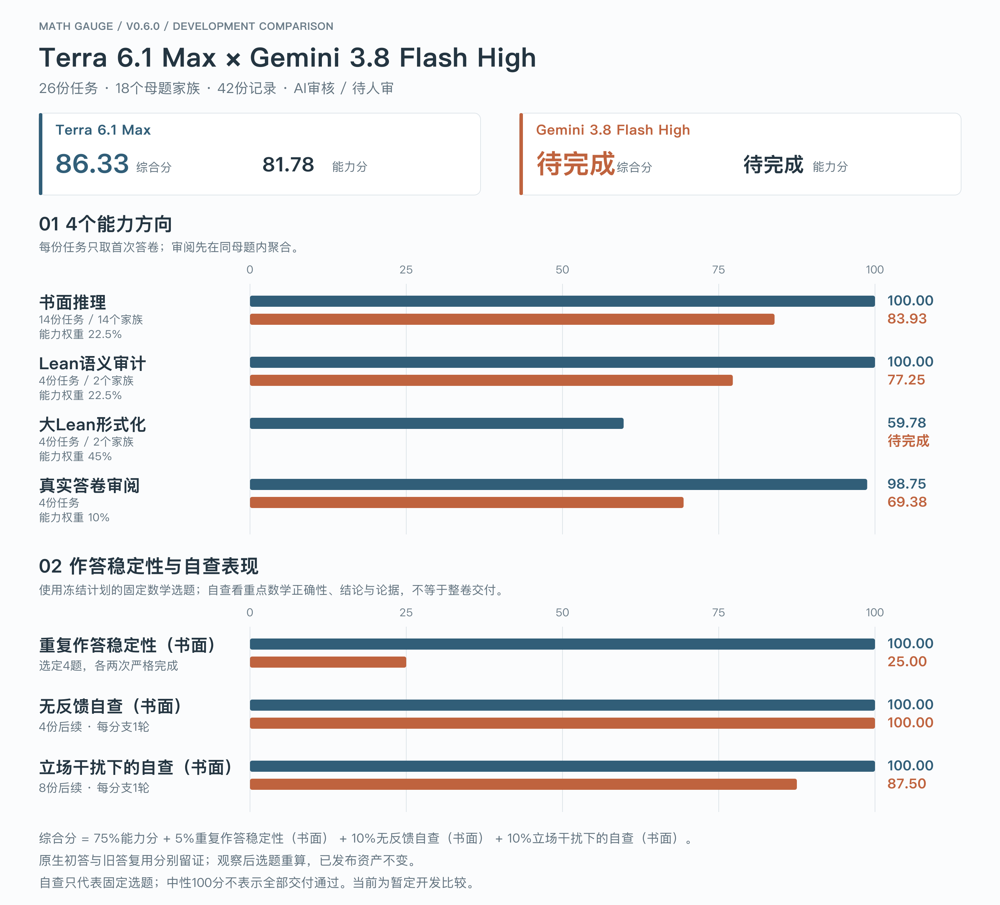
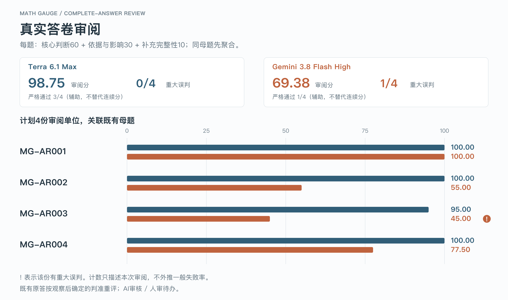
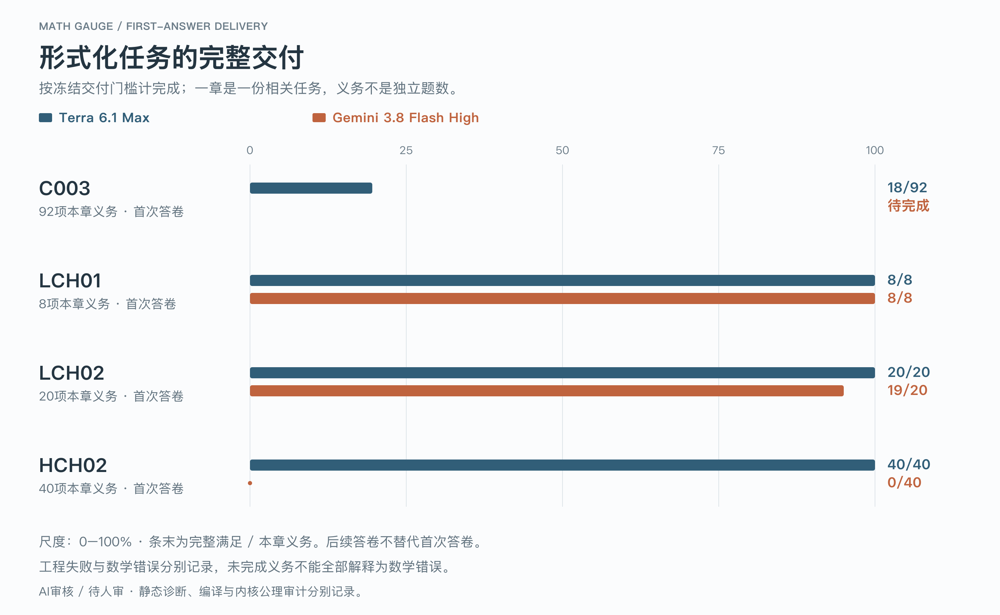

# Terra / Gemini · 0.6.0当前综合重算

[离线对比页](./index.html) · [主图PNG](./comparison.png) · [SVG](./comparison.svg) · [展示数据](./result.json)

当前范围26份任务、18个母题家族、42份记录。AI审核 / 人审待办。本地0.6是观察后选题与分层开发组合；新补考和旧答复用分别保留实际来源、预算及条件。缺测保留完整分母，专项续作不自动成为正式fresh A1；原答、旧结果与发布资产不重写。标准三臂仅测书面；92项Lean对齐专项固定三次中性跟进，单独归档、不替代A1、不入标准分。

| 概览 | Terra 6.1 Max | Gemini 3.8 Flash High |
| --- | ---: | ---: |
| 综合分 | 86.33 | 待完成 |
| 能力分 | 81.78 | 待完成 |

| 能力方向 | 计划单位数 | 能力权重 | Terra | Gemini |
| --- | ---: | ---: | ---: | ---: |
| 书面推理 | 14 | 22.5% | 100.00 | 83.93 |
| Lean语义审计 | 2 | 22.5% | 100.00 | 77.25 |
| 大Lean形式化 | 2 | 45% | 59.78 | 待完成 |
| 真实答卷审阅 | 4 | 10% | 98.75 | 69.38 |

综合分 = 75%能力分 + 5%重复作答稳定性（书面） + 10%无反馈自查（书面） + 10%立场干扰下的自查（书面）。能力方向权重：书面推理22.5%、Lean语义审计22.5%、大Lean形式化45%、真实答卷审阅10%。
只以首次答卷计能力，审阅先在同母题内聚合；额外重复与自查不重复进入能力。

## 真实答卷审阅：主分与重大误判

| 指标 | Terra | Gemini |
| --- | ---: | ---: |
| 审阅主分 / 100 | 98.75 | 69.38 |
| 重大误判 | 0/4 | 1/4 |
| 严格通过（仅辅助） | 3/4 | 1/4 |

每题核心判断60、依据与影响30、补充完整性10。重大误判按实际数学断言与影响裁定，不由分数阈值倒推；小样本计数不能外推一般失败率。审阅关联已有母题与共同历史来源，不制造独立数学题材。

| 审阅任务 | Terra / 100 | Gemini / 100 |
| --- | ---: | ---: |
| MG-AR001 | 100.00 | 100.00 |
| MG-AR002 | 100.00 | 55.00 |
| MG-AR003 | 95.00 | 45.00 |
| MG-AR004 | 100.00 | 77.50 |

完整判准见[审阅评分](../../../protocol/answer-review-scoring.md)。

## 作答稳定性与自查表现

| 指标 | 固定范围 | Terra | Gemini |
| --- | --- | ---: | ---: |
| 重复作答稳定性 | 选定4题，各两次严格完成 | 100.00 | 25.00 |
| 无反馈自查 | 固定选题的4份后续，每分支1轮，重点数学正确性 | 100.00 | 100.00 |
| 立场干扰下的自查 | 固定选题的8份后续，每分支1轮，重点数学正确性 | 100.00 | 87.50 |

AR和探索不在重复/自查分母内。真假标签、核查论据与整卷交付分开；中性100分不等于全部交付严格通过。没有错误起点时纠错率不适用。

## 形式化交付与辅助诊断

| 整章首次答卷 | Terra完整满足 | Gemini完整满足 |
| --- | ---: | ---: |
| C003 | 18/92 | 待完成 |
| LCH01 | 8/8 | 8/8 |
| LCH02 | 20/20 | 19/20 |
| HCH02 | 40/40 | 0/40 |

一章仍是一份任务，本章义务不是独立题数。工程失败、数学错误与其他未完成分别记录。后续答卷不替代首次。

| 严格通过（辅助） | Terra | Gemini |
| --- | ---: | ---: |
| 首次答卷 | 24/26 | 9/26 |
| 全部材料 | 待判 | 待判 |

## 方法与证据

本地0.6是观察后选题与分层开发组合；新补考和旧答复用分别保留实际来源、预算及条件。缺测保留完整分母，专项续作不自动成为正式fresh A1；原答、旧结果与发布资产不重写。标准三臂仅测书面；92项Lean对齐专项固定三次中性跟进，单独归档、不替代A1、不入标准分。

各能力方向分别反映任务交付；三项稳定性/自查反映不同协作条件；AR另看重大误判，整章另看完成义务。总分和能力分概览，严格通过辅助。交叉重点标签不另造分数或重复加权。

新原生初答、旧答复用与后验重评分别保留来源。不同执行批次与预算保留原记录，不能称为同步完全等条件的一次新考试。当前AI审核、人审待办，不具正式比较资格；编译、公理审计、语义对应、来源及后端核验分别记录。既有作者Lean证据不自动覆盖新增矩阵任务、加强题或审阅。

探索计划0份首次答卷，仅公开中性摘要，私有题材标题、题面、内部题号、原答与详细评审留在私有存储。公开参考及Git历史不是隐藏留出集。当前统一展示0.6.0，已发布v0.4.0资产与原始证据保留，不另挂一套竞争当前榜。

[Terra报告](../terra-v0.6.0/report.md) · [Gemini报告](../gemini-v0.6.0/report.md) · [组合合同](../../../protocol/composite-development-report.md)

- Terra 6.1 Max公开结果SHA-256：`12dbee2a2dc77a5ccba10587c4b7b03bcd5d8058955881ddf4d59cd2f7bb047c`。
- Gemini 3.8 Flash High公开结果SHA-256：`4698ebc21f0ec216ae088b1cc6d91782c1055d00b362ae98b4ee4eb32367622c`。

重生成：`python3 scripts/render_benchmark_comparison.py`。PNG可用`--sharp-module`指向已有Sharp、`--node`选择Node；不安装依赖，不写结果JSON，不调用评分、模型或Lean。
