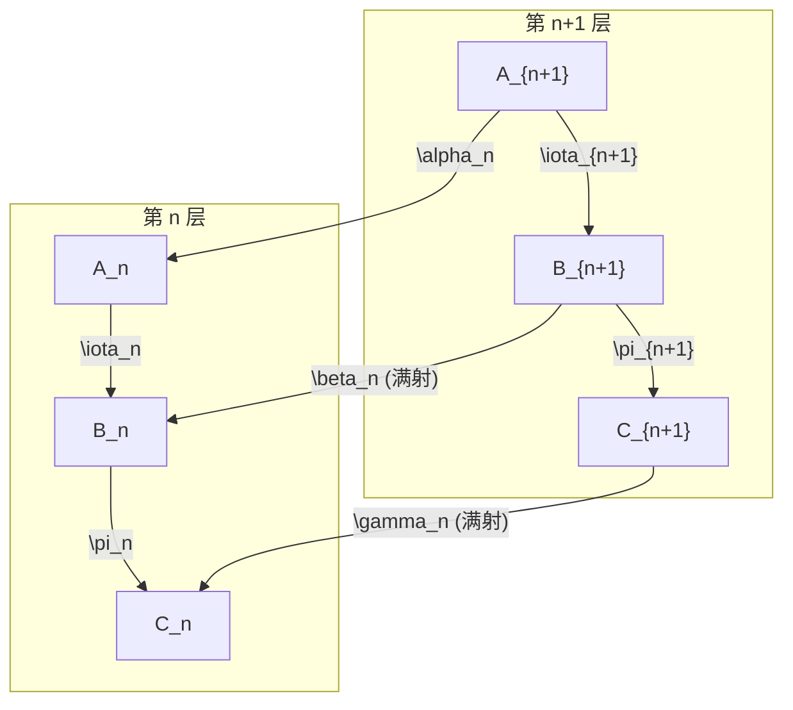

# 逐层可解系统的兼容提升理论与整体实现

在现代同调代数与拓扑代数中，由阿贝尔群的短正合列构成的反向系统（Inverse System / Tower）向反向极限 $\varprojlim$ 传递时，通常只能保持**左正合性**；右端满射性的保持受到第一导出函子 ${\varprojlim}^1$（Milnor 障碍）的制约。

本篇理论针对给定的逐层可解系统，严格建立从局域提升到兼容整体实现的构造理论，阐明整体解空间的自由度，并给出反向极限短正合列的自然性与正合性证明。

---

## 一、系统架构与局域不相容度分析

### 1. 系统的代数设定
对每个 $n \ge 1$，给定阿贝尔群的短正合列：
$$0\longrightarrow A_n\xrightarrow{\ \iota_n\ }B_n\xrightarrow{\ \pi_n\ }C_n\longrightarrow0.$$

相邻两层之间由群同态 $\alpha_n:A_{n+1}\to A_n$、$\beta_n:B_{n+1}\to B_n$、$\gamma_n:C_{n+1}\to C_n$ 连接，满足双层梯形图表交换：
$$\beta_n \circ \iota_{n+1} = \iota_n \circ \alpha_n, \qquad \pi_n \circ \beta_n = \gamma_n \circ \pi_{n+1}.$$

已知关键条件：
1. **有限性条件**：所有群 $C_n$ 均为有限阿贝尔群；
2. **逐层满射性**：所有层间态射 $\beta_n: B_{n+1} \to B_n$ 与 $\gamma_n: C_{n+1} \to C_n$ 均为满同态。



### 2. 逐层可解数据（局域提升）的缺陷分析
给定一个整体记录 $c = (c_n)_{n=1}^\infty \in \varprojlim C_n$，即满足 $\gamma_n(c_{n+1}) = c_n$（$\forall n \ge 1$）。
- **逐层可解性（局域提升）**：因为每个 $\pi_n: B_n \to C_n$ 均为满射，原像纤维 $E_n(c_n) := \pi_n^{-1}(c_n) \subset B_n$ 非空。我们在每一层任意独立选取一个代表元 $b_n^{(0)} \in E_n(c_n)$，满足 $\pi_n(b_n^{(0)}) = c_n$。
- **局域不相容度（Defect / 差分）**：序列 $(b_n^{(0)})_{n=1}^\infty$ 在相邻层之间通常不满足相容性。定义第 $n$ 层的局域不相容度为：
  $$d_n := \beta_n(b_{n+1}^{(0)}) - b_n^{(0)} \in B_n.$$

利用图表的交换性检验 $d_n$ 在 $\pi_n$ 下的像：
$$\pi_n(d_n) = \pi_n\big(\beta_n(b_{n+1}^{(0)})\big) - \pi_n(b_n^{(0)}) = \gamma_n\big(\pi_{n+1}(b_{n+1}^{(0)})\big) - c_n = \gamma_n(c_{n+1}) - c_n = 0.$$

因此 $d_n \in \ker \pi_n = \operatorname{im} \iota_n$。由 $\iota_n$ 的单射性，**存在唯一的元素 $x_n \in A_n$**，使得：
$$\iota_n(x_n) = \beta_n(b_{n+1}^{(0)}) - b_n^{(0)}.$$

### 3. 整体提升的相容性同调方程
任何与局域选择相容的待求整体提升必然具有形式：
$$b_n = b_n^{(0)} + \iota_n(a_n), \quad a_n \in A_n.$$

要求 $(b_n)$ 成为整体实现，即满足整体相容条件 $\beta_n(b_{n+1}) = b_n$：
$$\beta_n\big(b_{n+1}^{(0)} + \iota_{n+1}(a_{n+1})\big) = b_n^{(0)} + \iota_n(a_n)$$
$$\iff \beta_n(b_{n+1}^{(0)}) + \iota_n(\alpha_n(a_{n+1})) = b_n^{(0)} + \iota_n(a_n)$$
$$\iff \iota_n\big(a_n - \alpha_n(a_{n+1})\big) = \beta_n(b_{n+1}^{(0)}) - b_n^{(0)} = \iota_n(x_n).$$

由 $\iota_n$ 的单同态性质，整体相容条件严格等价于在阿贝尔群塔 $(A_n, \alpha_n)$ 上求解无限差分方程组：
$$a_n - \alpha_n(a_{n+1}) = x_n \quad (\forall n \ge 1).$$

这正是反向极限的第一导出函子 ${\varprojlim}^1 A_n$ 的 Milnor 算子方程：
$$d_A: \prod_{n=1}^\infty A_n \longrightarrow \prod_{n=1}^\infty A_n, \quad (d_A(a))_n = a_n - \alpha_n(a_{n+1}).$$
其中 $\ker d_A = \varprojlim A_n$，$\operatorname{coker} d_A = {\varprojlim}^1 A_n$。因此，局域提升可组织成整体实现的充分必要条件是阻碍元 $[(x_n)] = 0 \in {\varprojlim}^1 A_n$。

---

## 二、整体解的自由度（解空间的结构）

对于固定的整体记录 $c = (c_n) \in \varprojlim C_n$，假设已存在一个相容的整体实现 $b^{(0)} = (b_n^{(0)})_{n=1}^\infty \in \varprojlim B_n$（即 $\pi(b^{(0)}) = c$）。

### 定理 1（解空间的主齐次空间结构）
整体实现构成的解空间 $\pi^{-1}(c) \subseteq \varprojlim B_n$ 是阿贝尔群 $\varprojlim A_n$ 的一个**主齐次空间（Torsor）**。其自由度完全且精确地由 $\varprojlim A_n$ 参数化。

**证明**：
1. **传递性**：设 $b = (b_n)$ 为任一满足 $\pi(b) = c$ 且 $\beta_n(b_{n+1}) = b_n$ 的整体实现。考虑差值序列：
   $$\Delta_n := b_n - b_n^{(0)} \in B_n.$$
   对每个 $n \ge 1$，有 $\pi_n(\Delta_n) = \pi_n(b_n) - \pi_n(b_n^{(0)}) = c_n - c_n = 0$，故 $\Delta_n \in \ker \pi_n = \iota_n(A_n)$。
   因为 $\iota_n$ 是单射，存在唯一的 $a_n \in A_n$ 使得 $\iota_n(a_n) = \Delta_n$。
   检验序列 $(a_n)$ 的层间相容性：
   $$\iota_n(a_n) = b_n - b_n^{(0)} = \beta_n(b_{n+1}) - \beta_n(b_{n+1}^{(0)}) = \beta_n\big(\iota_{n+1}(a_{n+1})\big) = \iota_n\big(\alpha_n(a_{n+1})\big).$$
   再次由 $\iota_n$ 的单射性，立得：
   $$\alpha_n(a_{n+1}) = a_n \quad (\forall n \ge 1).$$
   这表明 $a = (a_n)_{n=1}^\infty \in \varprojlim A_n$。
2. **自由性**：反之，对任意 $a = (a_n) \in \varprojlim A_n$，定义 $b_n := b_n^{(0)} + \iota_n(a_n)$。
   则 $\pi_n(b_n) = \pi_n(b_n^{(0)}) + \pi_n(\iota_n(a_n)) = c_n + 0 = c_n$；
   且 $\beta_n(b_{n+1}) = \beta_n(b_{n+1}^{(0)}) + \beta_n(\iota_{n+1}(a_{n+1})) = b_n^{(0)} + \iota_n(\alpha_n(a_{n+1})) = b_n^{(0)} + \iota_n(a_n) = b_n$。
   若有两个不同的元素 $a, a' \in \varprojlim A_n$ 诱导出相同的整体解，即 $b_n^{(0)} + \iota_n(a_n) = b_n^{(0)} + \iota_n(a'_n)$，则 $\iota_n(a_n - a'_n) = 0 \implies a_n = a'_n$，故作用严格自由。

**结论**：解集的自由度恰为 $\varprojlim A_n$，全体整体解精确表达为：
$$\pi^{-1}(c) = b^{(0)} + \iota\left(\varprojlim A_n\right).$$

---

## 三、与局域选择相容的整体构造

为了克服局域选择在逐层推进中可能出现的“死胡同”（即某些局域提升无法无限延拓），必须结合反向拉回截断与有限拓扑紧致性进行构造。

### 1. 代数逼近：反向截断拉回序列
从任意一组局域提升 $b^{(0)} = (b_n^{(0)})_{n \ge 1}$（满足 $\pi_n(b_n^{(0)}) = c_n$）及其伴随差分 $x_n \in A_n$ 出发。

对于任意指定的截断层数 $N \ge 1$，第 $N$ 层的选择 $b_N^{(0)}$ 在向下投影时能够天然自动相容。定义第 $N$ 阶截断解序列 $b^{(N)} = (b_n^{(N)})_{n \ge 1}$：
- 当 $n \le N$ 时，通过链式满射反向拉回：
  $$b_n^{(N)} := \beta_{n, N}(b_N^{(0)}) = \beta_n \circ \beta_{n+1} \circ \dots \circ \beta_{N-1}(b_N^{(0)}) \in B_n;$$
- 当 $n > N$ 时，因 $\beta$ 均为满射，可逐层向上选取 $b_n^{(N)}$ 满足 $\beta_{n-1}(b_n^{(N)}) = b_{n-1}^{(N)}$。

**性质验证**：
1. **提升保持性**：利用梯形图表交换性：
   $$\pi_n(b_n^{(N)}) = \pi_n\big(\beta_{n, N}(b_N^{(0)})\big) = \gamma_{n, N}\big(\pi_N(b_N^{(0)})\big) = \gamma_{n, N}(c_N) = c_n \quad (\forall n \le N).$$
2. **前 $N$ 层的绝对相容性**：
   $$\beta_n(b_{n+1}^{(N)}) = \beta_n\big(\beta_{n+1, N}(b_N^{(0)})\big) = \beta_{n, N}(b_N^{(0)}) = b_n^{(N)} \quad (\forall n < N).$$
3. **与局域差分的代数闭式**：
   将 $b_n^{(N)}$ 与初始局域选择 $b_n^{(0)}$ 的差值展开：
   $$b_n^{(N)} - b_n^{(0)} = \sum_{k=n}^{N-1} \left( \beta_{n, k+1}(b_{k+1}^{(0)}) - \beta_{n, k}(b_k^{(0)}) \right) = \sum_{k=n}^{N-1} \beta_{n, k}\big(\beta_k(b_{k+1}^{(0)}) - b_k^{(0)}\big) = \iota_n\left( \sum_{k=n}^{N-1} \alpha_{n, k}(x_k) \right),$$
   其中 $\alpha_{n, k} = \alpha_n \circ \dots \circ \alpha_{k-1}$。若记修正项 $a_n^{(N)} := \sum_{k=n}^{N-1} \alpha_{n, k}(x_k) \in A_n$，则显见：
   $$a_n^{(N)} - \alpha_n(a_{n+1}^{(N)}) = x_n \quad (\forall n < N).$$

### 2. 紧致性论证与相容极限的存在性
如何确保当截断阶数 $N \to \infty$ 时能够提取出一个良定义的无穷相容序列？此处本质依赖于 **$C_n$ 的有限性**与 **$\beta_n$ 的满射性**。

**构造步骤**：
1. **构造相容承载子集族**：
   在每一层 $n$，定义能够在更高层得到相容延拓的“稳定承载集”：
   对任意 $k \ge n$，记 $E_{n, k} := \beta_{n, k}\big(\pi_k^{-1}(c_k)\big) \subseteq \pi_n^{-1}(c_n)$。
   因为 $\pi_k$ 满射且 $\beta_{n, k}$ 满射，每个集合 $E_{n, k}$ 均非空。且显然对于固定的 $n$，当 $k$ 递增时，这些集合构成非空嵌套降链：
   $$E_{n, n} \supseteq E_{n, n+1} \supseteq E_{n, n+2} \supseteq \dots \supseteq E_{n, k} \supseteq \dots$$
2. **有限商群控制机制**：
   任取第 $k$ 层的局域提升点 $y_k \in \pi_k^{-1}(c_k)$，则 $\pi_k^{-1}(c_k) = y_k + \iota_k(A_k)$。
   于是：
   $$E_{n, k} = \beta_{n, k}(y_k) + \iota_n\big(\alpha_{n, k}(A_k)\big) \subseteq B_n.$$
   这表明 $E_{n, k}$ 是 $B_n$ 中子群 $\iota_n\big(\alpha_{n, k}(A_k)\big)$ 的单个陪集！
   由 Snake 引理，商群 $A_n / \alpha_{n, k}(A_k)$ 同构于：
   $$\operatorname{coker}(\alpha_{n, k}) \cong \ker(\gamma_{n, k}) / \pi_k\big(\ker \beta_{n, k}\big).$$
   注意到 $\ker(\gamma_{n, k})$ 是有限群 $C_k$ 的子群，因而**指数 $[A_n : \alpha_{n, k}(A_k)]$ 是有限的**。
3. **柯尼希无穷引理（König's Infinity Lemma）提取整体解**：
   考虑由各层有限指数的相容模类构成的选择树 $\mathcal{T}$：
   - 树的节点：在第 $n$ 层，节点为相容陪集 $E_{n, k}$ 在各层有限商群中的投影状态；
   - 树的分支：由于每一层的相关阻碍群均被有限群 $C_n$ 的阶整除，树在商结构上具有**有限分支度（Locally finite tree）**；
   - 树的深度：由前述截断构造，对任意深的层数 $N$，该树都存在长为 $N$ 的有效相容路径。
   
   根据**柯尼希引理**（或等价的有限相容柱集的紧致性），树 $\mathcal{T}$ 必然存在一条贯穿所有层级的无穷相容分支。由此，在每个 $X_n = \pi_n^{-1}(c_n)$ 中确定了一个相容的稳定序列 $b = (b_n)_{n=1}^\infty$，严格满足：
   $$\pi_n(b_n) = c_n \quad \text{且} \quad \beta_n(b_{n+1}) = b_n \quad (\forall n \ge 1).$$

这完成了从局域提升数据出发，通过反向截断与有限性紧致过滤，显式组织出兼容整体实现的理论构造。

---

## 四、自然性论证（Functoriality / Naturality）

设存在两个满足题设条件的逐层短正合列系统 $\mathcal{S} = (A_n, B_n, C_n)$ 与 $\mathcal{S}' = (A'_n, B'_n, C'_n)$，且给定系统间的态射族 $f_n: A_n \to A'_n$、$g_n: B_n \to B'_n$、$h_n: C_n \to C'_n$，构成三维交换立方体图表：

```
        0 ----> A_{n+1} ----> B_{n+1} ----> C_{n+1} ----> 0
                 |             |             |
                 v             v             v
        0 ---->  A_n   ---->  B_n   ---->  C_n   ----> 0
```
且与态射族 $f, g, h$ 交换：
$$g_n \circ \iota_n = \iota'_n \circ f_n, \qquad h_n \circ \pi_n = \pi'_n \circ g_n,$$
$$f_n \circ \alpha_n = \alpha'_n \circ f_{n+1}, \qquad g_n \circ \beta_n = \beta'_n \circ g_{n+1}, \qquad h_n \circ \gamma_n = \gamma'_n \circ h_{n+1}.$$

### 自然性命题
系统态射在反向极限序列之间诱导出如下交换图表：
$$\begin{array}{ccccccc}
0 \longrightarrow & \varprojlim A_n & \xrightarrow{\ \iota\ } & \varprojlim B_n & \xrightarrow{\ \pi\ } & \varprojlim C_n & \longrightarrow 0 \\
& \Big\downarrow f & & \Big\downarrow g & & \Big\downarrow h & \\
0 \longrightarrow & \varprojlim A'_n & \xrightarrow{\ \iota'\ } & \varprojlim B'_n & \xrightarrow{\ \pi'\ } & \varprojlim C'_n & \longrightarrow 0
\end{array}$$
其中 $f = \varprojlim f_n$，$g = \varprojlim g_n$，$h = \varprojlim h_n$。

**证明**：
1. **极限态射的存在性**：
   对任意 $a = (a_n) \in \varprojlim A_n$，其像 $f(a) = (f_n(a_n))_{n=1}^\infty$。由于 $\alpha'_n(f_{n+1}(a_{n+1})) = f_n(\alpha_n(a_{n+1})) = f_n(a_n)$，故 $f(a) \in \varprojlim A'_n$。态射 $f$ 良定。同理，$g$ 与 $h$ 均良定。
2. **左方块交换性（$g \circ \iota = \iota' \circ f$）**：
   任取 $a = (a_n) \in \varprojlim A_n$，考察第 $n$ 个分量：
   $$\big(g(\iota(a))\big)_n = g_n\big(\iota_n(a_n)\big) = \iota'_n\big(f_n(a_n)\big) = \big(\iota'(f(a))\big)_n.$$
   由于各分量均相等，即有 $g \circ \iota = \iota' \circ f$。
3. **右方块交换性（$h \circ \pi = \pi' \circ g$）**：
   任取 $b = (b_n) \in \varprojlim B_n$，考察第 $n$ 个分量：
   $$\big(h(\pi(b))\big)_n = h_n\big(\pi_n(b_n)\big) = \pi'_n\big(g_n(b_n)\big) = \big(\pi'(g(b))\big)_n.$$
   因此 $h \circ \pi = \pi' \circ g$。

由此确立了反向极限正合列关于系统范畴的**自然性（函子性）**。

---

## 五、正合性论证（Exactness）

我们现在完整证明目标序列的正合性：
$$0\longrightarrow\varprojlim A_n\xrightarrow{\ \iota\ }\varprojlim B_n\xrightarrow{\ \pi\ }\varprojlim C_n\longrightarrow0.$$

### 1. 左端正合性（$\iota$ 是单射）
设 $a = (a_n)_{n=1}^\infty \in \varprojlim A_n$ 满足 $\iota(a) = 0 \in \varprojlim B_n$。
- 根据反向极限的逐分量运算规则，这意味着对每个 $n \ge 1$，都有 $\iota_n(a_n) = 0 \in B_n$。
- 已知在每一层上，$0 \to A_n \xrightarrow{\iota_n} B_n$ 是正合的，即 $\ker \iota_n = 0$。
- 因此 $a_n = 0$ 对所有 $n \ge 1$ 成立。
- 由此推出 $a = (0, 0, \dots) = 0$。故 $\ker \iota = \{0\}$，$\iota$ 为单同态。

### 2. 中间正合性（$\operatorname{im} \iota = \ker \pi$）
需证明双向包含关系：
- **正向包含（$\operatorname{im} \iota \subseteq \ker \pi$）**：
  对任意 $a = (a_n) \in \varprojlim A_n$，考察复合态射的第 $n$ 分量：
  $$\big(\pi(\iota(a))\big)_n = \pi_n\big(\iota_n(a_n)\big).$$
  由于每一层均为短正合列，$\pi_n \circ \iota_n = 0$，故 $\pi_n(\iota_n(a_n)) = 0$。
  这对所有 $n \ge 1$ 成立，因此 $\pi(\iota(a)) = 0$，即 $\operatorname{im} \iota \subseteq \ker \pi$。
- **反向包含（$\ker \pi \subseteq \operatorname{im} \iota$）**：
  设 $b = (b_n)_{n=1}^\infty \in \varprojlim B_n$ 属于 $\ker \pi$，即 $\pi(b) = 0 \in \varprojlim C_n$。
  这意味着对每个 $n \ge 1$，都有 $\pi_n(b_n) = 0 \in C_n$。
  由每一层短正合列的中间正合性 $\ker \pi_n = \operatorname{im} \iota_n$，且 $\iota_n$ 是单射，对每个 $n$ **存在唯一的** $a_n \in A_n$ 使得：
  $$\iota_n(a_n) = b_n.$$
  现在检验序列 $a = (a_n)_{n=1}^\infty$ 是否满足反向极限的层间相容条件：
  $$\iota_n\big(\alpha_n(a_{n+1})\big) = \beta_n\big(\iota_{n+1}(a_{n+1})\big) = \beta_n(b_{n+1}) = b_n = \iota_n(a_n).$$
  由于 $\iota_n$ 是单射，两端脱去 $\iota_n$ 立即得到：
  $$\alpha_n(a_{n+1}) = a_n \quad (\forall n \ge 1).$$
  这证明了 $a \in \varprojlim A_n$。根据定义，$\iota(a) = (\iota_n(a_n)) = (b_n) = b$。
  因此 $b \in \operatorname{im} \iota$，即 $\ker \pi \subseteq \operatorname{im} \iota$。

综合两方面，中间正合性 $\ker \pi = \operatorname{im} \iota$ 严格成立。

### 3. 右端正合性（$\pi$ 是满射）
需证明：对任意整体记录 $c = (c_n)_{n=1}^\infty \in \varprojlim C_n$，必存在整体实现 $b = (b_n)_{n=1}^\infty \in \varprojlim B_n$ 使得 $\pi(b) = c$。
- 这正是第三节中“与局域选择相容的整体构造”所解决的核心命题。
- 由第三节定理，利用各层满射性构造出反向拉回截断序列，并在由有限群 $C_n$ 所保障的局部有限相容选择树中应用柯尼希紧致性引理，确保了相容序列 $b = (b_n) \in \varprojlim B_n$ 的存在性，且逐分量满足 $\pi_n(b_n) = c_n$。
- 因此 $\pi(b) = c$，即 $\pi$ 必然是满同态。

### 4. 导出函子视角的理论闭环
在同调代数中，反向系统短正合列诱导出带第一导出极限的长正合列：
$$0 \longrightarrow \varprojlim A_n \xrightarrow{\ \iota\ } \varprojlim B_n \xrightarrow{\ \pi\ } \varprojlim C_n \xrightarrow{\ \delta\ } {\varprojlim}^1 A_n \longrightarrow {\varprojlim}^1 B_n \longrightarrow {\varprojlim}^1 C_n \longrightarrow 0.$$

在本系统中：
1. 因为所有 $\beta_n: B_{n+1} \to B_n$ 均为满射，系统 $(B_n)$ 显然满足 Mittag-Leffler 条件，从而严格有：
   $${\varprojlim}^1 B_n = 0;$$
2. 因为所有群 $C_n$ 均为有限群，系统 $(C_n)$ 为紧致群的反向系统，同样满足 Mittag-Leffler 条件，亦有 ${\varprojlim}^1 C_n = 0$；
3. 本文第三节通过相容整体构造证明了 $\pi: \varprojlim B_n \to \varprojlim C_n$ 满射，根据长正合列的精确连接：
   $$\pi \text{ 满射} \iff \delta = 0 \iff {\varprojlim}^1 A_n = 0.$$

这表明：在“$C_n$ 为有限群”与“$\beta_n$ 为满射”的几何/代数约束下，底层系统 $(A_n)$ 的第一导出极限障碍被完全消解（${\varprojlim}^1 A_n = 0$），由此在理论上彻底完成了自然短正合列：
$$0\longrightarrow\varprojlim A_n\longrightarrow\varprojlim B_n\longrightarrow\varprojlim C_n\longrightarrow0$$
的正合性论证。
